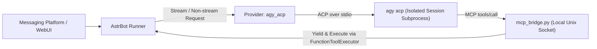

```markdown
<p align="center">
  
</p>

# AstrBot Antigravity ACP (`astrbot_plugin_antigravity_acp`)


-brightgreen)

通过 Google 官方 `agy` 客户端内置的 ACP（Agent Client Protocol）协议，将 Antigravity 接入 AstrBot 作为日常对话模型使用。

---

## 💡 为什么这份 README 分成了两部分？

现在大家装插件、查报错或者改代码，很多时候会直接把仓库丢给 Claude Code、Cursor 或者各种 AI 助手。但**人类和 AI 读文档的需求完全是反过来的**：
- **人类看文档**：只想知道这插件干嘛用的、会不会封号、怎么用最快的速度跑起来，不想一上来就被密密麻麻的底层协议和目录树劝退。
- **AI 看文档**：不需要听背景故事，它需要的是高密度的架构契约、参数边界、文件路径和排障决策树，这样才不会在帮你配置或改代码时瞎猜（产生幻觉）。

所以这份文档一分为二。**如果你在安装使用中遇到问题，可以直接把本仓库链接或 README 丢给你的 AI 助手，让它直接读取下半部分帮你排查。**

📖 **快速跳转**：
- [👤 给人类看的说明（背景定位 / 核心优势 / 安装教程 / 避坑事项）](#-给人类看的说明)
- [🤖 给 Agent 看的上下文（架构契约 / 配置规范 / 排障 SOP）](#-给-agent-看的上下文)

---

# 👤 给人类看的说明

## 1. 背景与定位

前阵子在 L 站看到大佬写的 `dsh-antigravity-acp`，直接调官方 CLI 走标准协议通信，思路非常干净。我看了一眼 AstrBot 的插件市场，发现还没有类似的实现，就参考这个思路搬运并适配了一版。

做这个插件最大的动力，其实是因为**我自己被 Google 杀号杀怕了**。

折腾过反代、抓包提取 OAuth Token、或者接过各种野生号池的朋友应该都懂，账号风控是玄学，哪天睡醒号就没了。所以这个插件从立项开始就定死了路线：**只走官方客户端留的正常接口，不碰任何逆向和黑科技。**

### 明确一下本插件的边界（做什么 vs 不做什么）

| ✅ 这个插件做什么 | ❌ 这个插件坚决不做什么（过去没有，以后也不加） |
| :--- | :--- |
| 调用本机安装的官方 `agy` 客户端，走标准 stdio 管道通信 | **不做号池切换与多号轮询**：单实例只绑定当前机器登录的一个账号 |
| 把 AstrBot 的对话、图片和工具调用桥接给 `agy` | **不做上下文破限**：原样传递 AstrBot 上下文，不塞任何破限提示词 |
| 提供 WebUI 向导，辅助完成官方登录和模型选择 | **不做客户端伪造**：不拦截篡改流量，不伪装其他 IDE 指纹 |
| 隔离运行目录，锁死 `agy` 自带的本地高危工具 | **不提取 OAuth Token**：插件不读写账号凭证，登录态全归官方客户端管 |

---

## 2. 核心优势

Google 官方的命令行工具 `agy` 自带了一个 `agy acp` 子命令。本插件的作用就是在后台拉起你本机的 `agy`，把 AstrBot 的消息传过去，再把回复接回来。

相比传统的反代方案，这样做有几个实在的好处：
1. **不反代、不违规、保号优先**：全程调用本机官方客户端完成通信，没有第三方中转，最大程度降低风控风险。
2. **免 API Key、免额外部署**：不需要申请 API Key，也不用再单独起一个 HTTP 反代服务。只要本机 `agy` 登录了账号就能直接用。
3. **支持工具调用与多模态**：通过内置的本地 MCP 桥接，模型可以直接调用 AstrBot 里的插件工具（如 TTS 语音、查天气、代码沙箱等），也支持发图识图和调节思考深度（Reasoning）。
4. **锁死本地高危权限**：`agy` 本身是个能读写本地文件、执行终端命令的 Agent。为了防止机器人在群里被人用提示词注入把服务器搞崩，插件在启动 `agy` 时**强制关闭了它自带的所有本地文件与终端工具**。它只负责对话，工具执行全交由 AstrBot 自身的权限体系托管。

---

## 3. 安装与操作教程

### 第一步：安装官方 `agy` 客户端
在运行 AstrBot 的机器上（注意必须使用**运行 AstrBot 的同一个系统用户**），参考 [Google 官方文档](https://antigravity.google/docs/getting-started) 安装 `agy`。

安装完成后，在终端验证一下是否可用：
```bash
agy --version
agy acp --help
```
> 注：插件不会自动下载二进制文件。Windows 用户请确保使用的是原生 `agy.exe`，不支持 `.cmd` 或 `.bat` 包装脚本。

### 第二步：安装本插件
在 AstrBot WebUI 插件管理页上传 [主分支 ZIP 包](https://github.com/sl251/astrbot_plugin_antigravity_acp/archive/refs/heads/main.zip)，或者直接在 AstrBot 目录下克隆仓库：
```bash
git clone --branch main https://github.com/sl251/astrbot_plugin_antigravity_acp.git data/plugins/astrbot_plugin_antigravity_acp
```
安装后重载或重启插件。

### 第三步：完成首次设置（登录与选模型）
打开 **AstrBot WebUI → 插件 → Antigravity ACP → 首次设置**（也可以用管理员账号给机器人发 `/agy setup`）：

1. **检查环境**：页面会自动检测本机 `agy` 是否就绪。
2. **官方登录**：点击「开始官方登录」，复制生成的授权链接到浏览器完成登录（如果浏览器返回了回调地址或授权码，粘贴回页面提交即可）。**注意不要把授权码发到公开群聊里。**
3. **保存模型**：登录成功后，页面会拉取当前账号实际可用的模型列表。选择你需要的模型和思考档位（`default` / `low` / `medium` / `high`），点击 **「保存并启用模型」**。

### 第四步：切换模型
使用页面提示的 `/agy use <provider_id>` 命令，或者直接在 AstrBot 的提供商列表里切换到刚刚保存的模型即可。

---

## 4. 注意事项（避坑必看）

- **国内机器配置代理**：
  如果机器直连 Google 不通，可以在插件配置中将 `proxy_mode` 设为 `custom`，并在 `proxy_url` 填入代理地址（如 `http://127.0.0.1:7890`）。该代理仅注入给 `agy` 子进程，不影响 AstrBot 里的其他国内模型。
  *(Docker 部署注意：容器内的 `127.0.0.1` 指向容器自身，请填写宿主机内网 IP 或 `host.docker.internal`。)*
- **开启工具调用（Tool Use）与识图（Vision）需要开两个开关**：
  这两个功能默认关闭。如果需要开启：
  1. 先在 **插件配置** 中开启 `enable_tools` 或 `enable_images`，保存并重载插件；
  2. 再去 AstrBot 的 **模型 / 提供商配置** 中，为对应模型勾选 `tool_use` 或 `image` 能力。两边同时开启才会生效。
- **关于连通测试与额度**：
  插件「首次设置」里的检测、登录、拉取模型列表均不消耗对话额度。但 AstrBot 模型页自带的“连通测试”会实际发送一条测试消息，消耗少量额度；另外，模型保存成功仅代表协议握手通过，实际能否对话仍取决于账号自身是否有剩余额度。

---

## 5. 更新日志

*(详细技术变更见 [`CHANGELOG.md`](./CHANGELOG.md))*

- **v0.4.2 (当前版本)**：调整了启动策略，把环境预检放到后台静默执行，没装 `agy` 也不会卡住 AstrBot 启动了；清理了内部状态同步的冗余代码。
- **v0.4.1**：修了一波细节，去掉了没用的配置项，支持直接粘贴完整的 localhost 回调链接完成登录。
- **v0.4.0**：仓库正式改名为 `astrbot_plugin_antigravity_acp`；新增了 WebUI「首次设置」页面，登录、拉模型列表、调思考档位终于不用手搓配置文件了。
- **v0.3.x**：把 `agy` 自带的本地文件和终端工具权限彻底锁死；补上了发图识图支持（加了防 SSRF 和尺寸限制）；重构了进程池，解决了异常退出时留僵尸进程的问题。
- **v0.2.x**：写了个本地 MCP 桥接器，让 `agy` 能正常调用 AstrBot 里的插件工具；兼容了 TTS 这类直接发消息不返回文本的插件。
- **v0.1.0**：看到 L 站的 DSH 插件后摸出来的初版，跑通了基础的 `agy acp` 对话流程。

---
---

# 🤖 给 Agent 看的上下文

> **For AI Agents / LLMs**: 下方折叠区域包含本插件的架构契约、安全边界、配置字典与排障决策树。在协助用户部署、排障或修改代码时，请展开并严格遵循以下规范。

<details>
<summary><b>📂 点击展开：Architecture, Contracts, Config Schema & Troubleshooting SOP (Agent Context)</b></summary>

<br>

## 1. System Identity & Core Invariants (核心契约与安全边界)

- **Plugin ID / Repo**: `astrbot_plugin_antigravity_acp` (`v0.4.2`)
- **Registered Provider Type**: `agy_acp` (Native AstrBot Chat Provider)
- **Runtime Requirements**: AstrBot `>= 4.29.4, < 4.30` (Verified on `4.29.4`), Python `3.11+`, Zero third-party pip dependencies.
- **Compliance & Security Invariants (DO NOT VIOLATE)**:
  1. **No Token Extraction**: Never read, parse, export, or forward OAuth tokens from `agy` or OS keyrings (Linux Keyring / macOS Keychain / Windows Credential Manager). Auth lifecycle belongs strictly to the official `agy` binary.
  2. **No Reverse Proxy / Spoofing**: All model traffic must flow through the official `agy acp` subprocess over `stdio`. Do not implement HTTP interception, client fingerprint spoofing, account pooling, or jailbreak prompt injection.
  3. **Strict Capability Sandboxing**: Every `agy acp` subprocess MUST run with isolated `--gemini-dir`, `--app-data-dir`, and restricted `--agent` config under `data/plugin_data/astrbot_plugin_antigravity_acp/`. Built-in `agy` file/terminal tools are strictly disabled; any ACP request for local FS, terminal, or elevated permissions must be rejected immediately.

## 2. Architecture & Data Flow (数据流与会话管理)



- **Session Binding Key**: `(provider_instance_id, astrbot_session_id, conversation_id)`.
- **History Prefix Matching**: Reuses the live `agy acp` session if the message history prefix matches. If context compression, message editing, persona switching, or process eviction occurs, the session is rebuilt using AstrBot's authoritative history formatted as a role-tagged JSON transcript.
- **Host Tool Bridge (`mcp_bridge.py`)**: When `enable_tools=true`, host tools (`FunctionTool`, `MCPTool`, `HandoffTool`, and direct-send plugins like TTS returning `None`) are exposed to `agy acp` via a local Unix Socket MCP server. Automatically adapts AstrBot `skills_like` mode to `full` mode.
- **Process Pool & Cleanup**: Intra-session requests are serialized; cross-session requests run in parallel up to `max_concurrency`. Idle sessions are reaped via LRU pool. Process trees are terminated via process groups on Linux/macOS and `taskkill /T` on Windows.

## 3. File Layout (目录结构)

```text
data/plugins/astrbot_plugin_antigravity_acp/
├── main.py                  # Plugin entry, lifecycle hooks, /agy command & setup view registration
├── metadata.yaml            # AstrBot plugin metadata
├── _conf_schema.json        # Plugin configuration schema
├── agy_provider/            # Core ACP client, provider implementation, session pool, & MCP bridge
├── views/setup/             # Native WebUI setup wizard views
├── .astrbot-plugin/i18n/    # Internationalization resources
└── tests/                   # Unit and regression test suites
```
*(Constraint: Files must reside directly under `data/plugins/astrbot_plugin_antigravity_acp/`, never nested in an extra subfolder.)*

## 4. Configuration Reference (关键配置契约)

- **`command` (Binary Resolution)**:
  - Auto-searches `PATH`, `~/.local/bin/agy`, `%LOCALAPPDATA%/agy/bin/agy.exe`, and `~/.local/bin/agy.exe`.
  - If AstrBot runs as a systemd service or different user, set the absolute path in `command`.
  - **Windows Constraint**: Must point to native `agy.exe`. `.cmd` and `.bat` wrappers are NOT supported.
- **`proxy_mode` & `proxy_url`**:
  - Setting `proxy_mode=custom` injects `HTTP_PROXY` / `HTTPS_PROXY` / `ALL_PROXY` **only** into `agy` subprocesses.
  - **Docker Constraint**: Inside a container, `127.0.0.1` refers to the container itself. Use `host.docker.internal` or the bridge IP.
- **`thought_level` / `agy_thought_level`**:
  - Valid values: `"default"`, `"low"`, `"medium"`, `"high"`.
  - Per-model override via AstrBot model `custom_extra_body`: `{"agy_thought_level": "high"}`. Unsupported levels raise an explicit validation error.
- **Dual-Switch Contract (Tools & Vision)**:
  - **Tools**: Requires BOTH plugin config `enable_tools = true` (reload plugin) AND model capability `tool_use` checked in AstrBot Provider settings.
  - **Images**: Requires BOTH plugin config `enable_images = true` (reload plugin) AND model capability `image` checked. Supports up to 8 PNG/JPEG images per turn (validated against SSRF, format, and pixel bounds; local paths must reside within trusted `media_roots`). Audio, video, PDF, and image generation are NOT supported.
- **Legacy Migration (`<= v0.3.2`)**:
  - Stop AstrBot -> copy `data/config/astrbot_plugin_agy_provider_config.json` to `data/config/astrbot_plugin_antigravity_acp_config.json` -> disable old plugin -> start new plugin.

## 5. Diagnostic SOP for Agents (排障决策树)

1. **`agy` Not Found / Spawn Error**:
   - Verify `agy --version` and `agy acp --help` under the **exact OS user** running AstrBot.
   - On Windows, verify `command` points to `.exe` and not `.cmd`/`.bat`.
2. **Login / Auth Failure**:
   - Instruct user to use WebUI `首次设置` (`agy acp --login`) or run `agy` interactively in the host terminal under the same OS user.
   - Check `proxy_mode` / `proxy_url` if the host cannot reach Google directly.
3. **Tools or Vision Not Triggering**:
   - Verify the Dual-Switch Contract (Plugin Config switch + Provider Model Capability checkbox + plugin reload).
4. **Setup Passed but Chat Fails**:
   - Distinguish states: `Login Complete` != `ACP Handshake Passed` != `Model Saved` != `Live Generation Succeeded`. Setup checks do not send prompts; live chat failure indicates quota exhaustion, upstream rate limiting, or network timeout during streaming.

</details>

---

## 致谢与协议

- 灵感来源：感谢 L 站大佬的 `dsh-antigravity-acp` 插件提供的思路。
- 开源协议：详见 [`LICENSE`](./LICENSE) 与 [`THIRD_PARTY_NOTICES.md`](./THIRD_PARTY_NOTICES.md)。
- 免责声明：本插件仅作为本地官方 `agy` 客户端与 AstrBot 之间的协议适配器，与 Google 官方无关。请遵守 Google Antigravity 官方服务条款使用。
```
