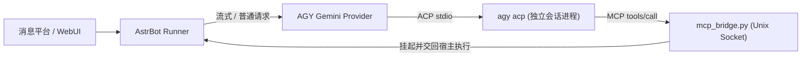

<p align="center"></p>

# AstrBot AGY Gemini Provider (`astrbot_plugin_agy_provider`)

把本机已登录的官方 Google Antigravity CLI（`agy`）通过官方 ACP（Agent Client Protocol）协议接入 **AstrBot**，作为原生聊天模型提供商（`agy_acp`）使用。

**不逆向、不反代、不依赖 Docker、无需额外 HTTP 网关。** 登录态留在官方 `agy` 进程与系统凭据库中，插件不提取、不保存也不转发任何 OAuth Token，在 AstrBot WebUI 中免填 API Key 即可直接调用 Gemini 模型、思考流、原生工具与图片输入。

---

## 工作方式



| 环节 | 做法 |
|---|---|
| **进程与登录态** | 由插件按需启动本机官方 `agy acp` 子进程，凭据留在官方 CLI 与系统凭据库（Linux Keyring / macOS 钥匙串 / Windows 凭据管理器），Provider 配置无需填写 URL 或 API Key |
| **安全隔离** | 每个会话使用位于 `data/plugin_data/astrbot_plugin_agy_provider/` 下的受限 `--gemini-dir`、`--app-data-dir` 与受限 `--agent` 配置；**禁用 AGY 全部内置文件/终端工具**，任何 ACP 本地文件、终端或权限请求一律拒绝 |
| **模型与思考** | 自动从 `agy acp` 读取当前账号实际可用的 Gemini 模型列表；支持普通与流式回复、独立思考过程（Reasoning）输出，以及 `default` / `low` / `medium` / `high` 四档思考强度 |
| **会话与历史** | 按 `Provider 实例 + AstrBot session_id + conversation_id` 绑定独立会话进程；历史前缀一致时直接复用同一 ACP 会话，发生上下文压缩、编辑、切换模型/人格或进程回收后，按 AstrBot 权威历史以带角色的 JSON 转录重建 |
| **原生工具桥** | 启用 `enable_tools` 后，通过本地 Unix Socket MCP 桥（`mcp_bridge.py`）将工具调用交回 AstrBot 原生执行器处理，支持 `FunctionTool`、`MCPTool`、`HandoffTool` 及直接发送型插件（如语音 TTS），并自动将 `skills_like` 适配为 `full` 模式 |
| **图片输入** | 启用 `enable_images` 后，支持 PNG / JPEG 图片输入（公网链接或受信任的本地 `media_roots` 目录），经格式、像素与防 SSRF 校验后以 ACP 原生 `image` 块发送 |

---

## 功能与能力对照

| 能力 | 当前支持情况 |
|---|---|
| **模型发现** | 自动拉取 `agy acp` 模型目录（缓存 5 分钟，建会话时二次校验） |
| **思考档位** | 支持全局默认档位与单模型 `custom_extra_body` 独立覆盖（`default` / `low` / `medium` / `high`） |
| **并发与排队** | 同会话内串行、跨会话并行；支持配置最大并发数、最大保留会话进程数（LRU 淘汰空闲会话）、最大排队数与空闲自动回收 |
| **宿主工具调用** | 默认关闭，通过 `enable_tools` 开启；由 AstrBot 原生 `FunctionToolExecutor` 执行并回填结果，支持语音插件返回 `None` 直接结束当轮对话 |
| **多模态输入** | 默认关闭，通过 `enable_images` 开启；支持单轮最多 8 张 PNG / JPEG 图片（图文混合或纯图输入），暂不支持音频、视频、PDF 与图片生成 |
| **生命周期清理** | Linux / macOS 使用独立进程组回收，Windows 使用 `taskkill /T` 回收进程树；插件重载或停用时自动清理子进程与临时会话目录 |

---

## 安装与快速上手

### 1. 环境准备

1. **AstrBot 版本**：已原生安装并正常运行 AstrBot `>= 4.29.4, < 4.30`（真实宿主验证过 4.29.4），Python 3.11+（本插件无额外第三方 pip 依赖）。
2. **安装并登录官方 AGY CLI**：在**运行 AstrBot 的同一台机器、同一个系统用户**下安装 [官方 Antigravity CLI (`agy`)](https://antigravity.google/docs/cli/acp/)，并在终端完成登录：
   ```sh
   agy login
   agy --version
   agy acp --help
   ```
   > **提示**：如果 AstrBot 以系统服务（systemd）或桌面 GUI 方式启动，环境变量 `PATH` 可能不包含 `agy`，届时只需在插件配置中填入 `agy` 的绝对路径即可（Windows 须使用原生 `agy.exe`，不支持 `.cmd` / `.bat` 包装脚本）。
3. **网络代理（可选）**：`agy` CLI 走标准 `HTTP_PROXY` / `HTTPS_PROXY` / `ALL_PROXY` 环境变量。需要为 AGY 单独配置代理时，在插件配置中选择 `proxy_mode=custom` 并填写 `proxy_url`（仅作用于 AGY 子进程，不影响 AstrBot 其他模型），保存后重载插件。Docker 用户注意**容器内 `127.0.0.1` 指容器自身**，需使用容器可达的宿主地址。

### 2. 安装插件

将本仓库克隆或解压到 AstrBot 数据目录的 `data/plugins/astrbot_plugin_agy_provider` 下（确保该目录下直接包含 `main.py`、`metadata.yaml` 和 `agy_provider/`，不要多套一层文件夹）：

```sh
# 在 AstrBot 根目录下执行
git clone --branch main https://github.com/sl251/sl251-astrbot-plugin-agy-provider.git data/plugins/astrbot_plugin_agy_provider
```

也可直接下载仓库主分支 ZIP 包，在 AstrBot WebUI 插件管理页选择本地上传安装。安装后重启或重载 AstrBot 插件。

### 3. 无生成自检（推荐）

由 AstrBot **管理员**在聊天中执行 `/agy doctor`：读取当前插件面板配置，依次检查 CLI、隔离认证、ACP 握手、会话与模型目录，**不发送对话、不消耗额度**。全部阶段通过后再继续下一步；报错时按输出的错误类别对照下方[错误分类表](#错误分类)排查。

### 4. 在 WebUI 中添加模型提供商

1. 进入 AstrBot WebUI **模型 / 提供商** 页面，点击新增提供商，选择 **AGY Gemini (ACP)**（类型标识为 `agy_acp`）。
2. **无需填写 API URL 和 API Key**（保持留空即可）。
3. 点击 **获取模型列表**，从返回的真实 Gemini 模型 ID 中选择需要的模型并添加启用。
4. **能力勾选说明**：
   - 默认仅需勾选 **文本**。
   - 若需要使用**工具调用**或**识图能力**，请先在「插件配置」中打开 `enable_tools` / `enable_images` 并重载插件，然后在模型配置中同步勾选 `tool_use` / `image`。
5. 将该模型设为当前聊天模型即可开始对话（注意：点击 WebUI 的“连通测试”会真实生成一条简短回复并消耗少量额度；仅点击“获取模型列表”不会发送对话）。

### 5. 单个模型自定义思考档位（可选）

如果需要为某个模型实例单独指定思考强度，可在该模型的 `custom_extra_body` 中配置：

```json
{"agy_thought_level": "high"}
```

可选值为 `"default"`、`"low"`、`"medium"`、`"high"`。设为 `"default"` 时继承插件全局配置；填写模型不支持的档位会明确报错。

---

## 配置说明

启动参数、并发限制与安全开关位于 **插件配置**（修改后需重载插件生效）；具体使用的模型 ID 位于 **AstrBot 模型提供商配置**。

### 基础、认证与代理配置

| 字段 | 默认值 | 说明 |
|---|---:|---|
| `command` | 空 | `agy` 可执行文件绝对路径。留空则自动从 `PATH` 和 `~/.local/bin/agy` 查找（Windows 请指定 `agy.exe`，不支持 `.cmd`/`.bat` 包装脚本） |
| `auth_bridge` | `true` | 认证桥：把隔离会话的认证入口符号链接到同一用户的官方 token 文件，实现安装即用；关闭后恢复纯隔离行为（见[认证与 Docker](#认证与-docker)） |
| `proxy_mode` | `inherit` | AGY 子进程代理模式：`inherit` 原样继承 AstrBot 环境；`custom` 按 `proxy_url` 覆盖；`direct` 移除 AGY 环境中的代理变量 |
| `proxy_url` | 空 | `proxy_mode=custom` 时必填，仅支持 `http://` 与 `socks5h://`，须含主机和端口；其他模式下忽略 |
| `thought_level` | `default` | 全局默认思考档位：`default`（使用 CLI 默认值）/ `low` / `medium` / `high` |
| `startup_timeout` | `60` | 进程启动、ACP 握手与模型初始化超时时间（秒）；也是 doctor 自检的总执行预算 |
| `request_timeout` | `180` | 单轮生成超时时间（秒） |
| `queue_timeout` | `60` | 等待会话锁与并发槽位的合计排队超时时间（秒） |
| `max_concurrent` | `2` | 每个模型实例的最大并发请求数（低配或小内存机器建议设为 `1`） |
| `max_sessions` | `4` | 每个模型实例最多保留的常驻会话进程数（不能小于 `max_concurrent`，超限按 LRU 淘汰空闲会话） |
| `max_pending` | `16` | 每个模型实例的最大排队等待请求数 |
| `idle_ttl` | `600` | 空闲会话进程自动回收时间（秒） |
| `history_bytes` | `160000` | 历史上下文重建时的 UTF-8 字节预算（范围 `4096`–`160000`，超限按完整旧轮次裁剪并标记） |
| `max_output_bytes` | `4194304` | 单轮回复正文与思考内容的合计字节上限（达到上限时返回已有内容，不自动续写） |

代理示例：`http://127.0.0.1:7890`、`socks5h://127.0.0.1:1080`，IPv6 写作 `http://[::1]:7890`。URL 不能包含空白、控制字符、反斜线、query、fragment 或业务路径；代理认证中的特殊字符需百分号编码。请勿将带凭据的 URL 粘贴到诊断消息或公开 issue。

`custom` 对 AGY 子进程的 `HTTP_PROXY`、`HTTPS_PROXY`、`ALL_PROXY` 及小写键使用同一 URL，并仅让回环地址免代理（`localhost,127.0.0.1,::1`）。`direct` 删除这六个代理键，保留其余环境；系统 VPN、透明代理或外部包装器仍可能影响网络。代理失败不会静默直连。设置仅影响 AGY 子进程，**不改变 AstrBot、其他插件或图片下载器**；图片下载保持独立直连策略。

> **注**：若在 AstrBot 中创建了多个 `agy_acp` 模型实例，各实例的并发与会话池相互独立，总进程上限会累加。

### 工具桥与图片输入配置

| 字段 | 默认值 | 说明 |
|---|---:|---|
| `enable_tools` | `false` | 是否启用宿主工具桥（需 POSIX Unix Socket 支持，故当前工具桥仅支持 Linux / macOS） |
| `tool_max_calls` | `16` | 单轮对话允许的最大工具调用次数 |
| `tool_max_concurrent` | `1` | 单轮同时处于待处理状态的最大工具数 |
| `tool_approval_timeout` | `60` | 工具调用到达至交接给宿主 Runner 的等待/审批超时（秒） |
| `tool_execution_timeout` | `120` | 宿主工具执行并回填结果的超时时间（秒） |
| `tool_result_bytes` | `262144` | 单轮工具返回结果的总字节预算（超限不截断，直接报错拒绝） |
| `enable_images` | `false` | 是否启用 PNG / JPEG 图片输入（需本机 `agy` CLI 报告支持 `image` 能力） |
| `media_roots` | `[]` | 允许读取本地图片的授权目录列表（必须为绝对路径且不含符号链接） |
| `image_max_count` | `8` | 单次请求（含历史上下文）允许的最大唯一图片张数 |
| `image_max_bytes` | `8388608` | 单次请求图片原始总字节上限（默认 8 MiB） |
| `image_max_pixels` | `20000000` | 单张图片最大像素数上限（默认 2000 万像素） |
| `image_timeout` | `15` | 单张远程图片下载或本地读取超时时间（秒） |

---

## 认证与 Docker

默认认证桥使用官方文件后端：`~/.gemini/antigravity-cli/antigravity-oauth-token`。插件只检查文件元数据和边界，并在隔离目录建立 `agy/antigravity-oauth-token` 符号链接；**不读取、打印、上传、复制或自行刷新 token 内容**，不链接整个 `~/.gemini`。目标须存在且非空，归属和父目录权限须安全，异常符号链接会被拒绝。会话清理只删除链接本身，不跟随链接删除持久 token。`--app-data-dir` 保持相对路径 `agy`。

`auth_bridge=false` 会恢复旧版纯隔离、无桥接行为。其他 keyring 后端、Windows/macOS 的真实认证与符号链接权限尚未验证，不能据 Linux 文件方案推断兼容性。

Docker 用户需同时注意：

- CLI、登录文件及其归属必须对**容器内运行 AstrBot 的用户**可用；宿主机已安装、已登录不等于容器内可用。只授权必要路径，勿把整个宿主 HOME 当作会话目录。
- **容器内 `127.0.0.1` 指容器自身**。宿主机代理需使用容器可达的宿主地址并配置其监听和访问权限；具体地址由部署网络决定。
- 保存插件配置后重载。无生成自检与 Runtime 使用同一插件数据根下的独立临时目录，避免路径授权不同造成假失败。

---

## 限制与注意事项

- **合规与安全边界**：插件仅通过官方 CLI 的标准 `acp` 协议通信，不实现客户端身份伪装、不修改官方二进制、不提供多账号池或 OAuth 反向代理。使用范围请遵循 Google 官方条款。
- **凭据刷新**：官方 token 的自然刷新与并发刷新行为尚未长期验证；短会话成功不证明长期刷新可靠。建议同一账号避免 CLI 与插件并发高频使用。
- **采样参数不生效**：由于 ACP 协议未开放采样参数通道，AstrBot 中的 `temperature`、`top_p`、`max_tokens` 等参数不会传递给 `agy`。
- **数据目录切勿整目录删除**：会话运行目录位于 `data/plugin_data/astrbot_plugin_agy_provider/`。正常退出时插件会自动清理临时会话目录；若容器或实例在同一数据树下配置了持久化认证状态，**请勿直接删空整个 `astrbot_plugin_agy_provider` 数据目录**，以免丢失登录态。官方 token 位于独立认证目录，勿作为临时文件删除。
- **工具调用边界**：
  - 仅支持 `tool_choice="auto"` 或 `"none"`，不支持强制指定函数（`required`）。
  - 工具返回结果仅支持文本或 JSON 文本，不支持工具直接返回二进制/图片块。
  - 原生工具桥依赖 Unix Domain Socket（`AF_UNIX`），需在 Linux / macOS 环境下使用，且临时目录路径不宜过长。
- **图片输入边界**：
  - 仅支持标准 8 位非交错 PNG 与 8 位 Baseline/Progressive JPEG。
  - 本地图片路径必须位于 `media_roots` 显式授权的目录内（拒绝符号链接与目录穿越）；公网图片仅允许标准 80/443 端口且自动拦截内网/回环地址。
  - 若 AstrBot 在进入 Provider 前已将图片过滤或清理了临时原图，插件无法恢复附件（请确保在模型设置中已勾选 `image` 能力）。

---

## 诊断预检与排错

### 1. 管理员自检 `/agy doctor`

管理员指令，有总时限和并发保护，普通用户不可用。输出只包含阶段、CLI 版本、代理模式、模型目录状态等脱敏信息（不输出完整代理 URL、系统用户名、OAuth 地址、账号标识或原始 stderr）。自检通过后再进行连通测试。

### 2. 终端零消耗预检（Probe）

如果遇到连接失败或报 `AUTH`（`Authentication required` / `-32000`）错误，也可在 AstrBot 对应环境中不发起对话、不消耗模型额度地运行内置预检：

```sh
python -m agy_provider.probe
# 或显式指定 agy 路径：
python -m agy_provider.probe --command /path/to/agy
```

退出码 `0` 表示握手与建会话成功；退出码 `2` 表示存在阻塞问题（输出仅含脱敏阶段、错误分类与白名单能力）。终端入口使用自己的命令行配置，不会自动读取面板配置；代理默认继承终端环境。

### 3. 错误分类

| 错误类别 | 下一步 |
|---|---|
| `CONFIG` | 检查命令路径、代理模式与 URL 格式，修改后重载 |
| `NOT_INSTALLED` | 在 AstrBot 实际运行环境安装官方 CLI，或填写正确绝对路径 |
| `PERMISSION` / `LAUNCH` | 检查可执行权限、服务用户与平台子进程支持；不要改成 shell 命令 |
| `UNSUPPORTED` | 检查官方 CLI 的 ACP 与隔离启动能力，按官方方式处理版本 |
| `AUTH` | 用相同系统用户运行 `agy` 登录；检查官方 token 文件、归属、父目录权限与认证桥开关 |
| `PROXY_AUTH` | 代理认证失败（例如 HTTP 407）；检查代理服务认证，不要反复登录 Google |
| `PROXY` | 检查代理地址、端口、协议、容器可达性及代理服务状态 |
| `NETWORK` | 检查 DNS、网络出口及连接；不要将代理密码或原始日志发到聊天 |
| `TLS` | 检查系统时间、证书链及代理的 TLS 设置 |
| `TIMEOUT` | 按失败阶段检查网络与 CLI 响应，确认无卡住的代理，再考虑适当增加时限 |
| `RATE_LIMIT` | 请求频率受限，降低并发并稍后再试 |
| `QUOTA` | 检查官方 CLI 的额度或上游容量；不自动换账号或重放请求 |
| `UPSTREAM` / `TRANSPORT` / `PROTOCOL` | 按官方 CLI 检查模型和 ACP 兼容性，报告脱敏类别、阶段与版本 |

未知 JSON-RPC `-32000` 不直接等同于未登录，403 也不等同于封号。模型目录最多缓存 5 分钟；实际生成时仍会校验模型。获取目录、自检和宿主连通测试是不同操作。

### 4. 开发与回归测试

```sh
# 运行离线单元测试（使用模拟 ACP，不联网、不消耗额度）
python -m unittest discover -s tests

# 配置项与 schema 一致性检查 + 静态检查
python -m scripts.check_defaults
ruff check .
```

更多底层协议契约、工具桥设计与真实链路验收脚本说明，请参阅仓库 `docs/` 目录下的详细文档：

- [变更记录](CHANGELOG.md)
- [实施计划](docs/PLAN.md)
- [M2/M3 工具与图片实现说明](docs/M2_M3_IMPLEMENTATION.md)
- [ACP 原生执行兼容核验](docs/NATIVE_COMPAT_AUDIT.md)
- [M0 工具桥决策与预检交接](docs/TOOL_BRIDGE_DESIGN.md)
- [测试矩阵](docs/TEST_MATRIX.md) 与 [测试交接](docs/TEST_HANDOFF.md)
- [下一阶段任务书](docs/NEXT_PHASE_TASKBOOK.md)
- [第三方参考与许可](THIRD_PARTY_NOTICES.md)
