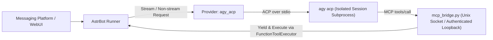

<p align="center">
  
</p>

# AstrBot Antigravity ACP (`astrbot_plugin_antigravity_acp`)


> **当前正式版本 0.6.1（2026-11-16 发布）**。0.6.1 修复 #11–#14（MCP 权限分层、schema 契约分离、权限拒绝归因、能力声明过滤），全量离线回归 222 项（210 通过 / 12 按平台跳过）与生产实机 webchat 验收完成，详见 [CHANGELOG](CHANGELOG.md)。0.6.0 的生产实机验收（AstrBot 4.29.4 + AGY CLI 1.5.8，含真实 429 限流风暴下的快速中断与 fallback 兜底）见 [PR #9 验收记录](docs/pr9-acceptance.md)；实施范围与回滚方式见 [改进计划](docs/liftgate-hardening-plan.md)。

通过 Google 官方 `agy` 客户端内置的 ACP（Agent Client Protocol）协议，将 Antigravity 接入 AstrBot 作为日常对话模型使用。

> **开发中的 WebUI 监控面板**：计划扩展运行概览、上下文占用、Token/缓存趋势、会话复用与故障诊断，见 [开发计划与 TODO](docs/webui-observability-dashboard-plan.md)（仅计划，功能尚未实现）。

---

## 💡 为什么这份 README 分成了两部分？

现在大家装插件、查报错或者改代码，很多时候会直接把仓库丢给 各种 AI 助手。但**人类和 AI 读文档的需求完全是反过来的**：
- **人类看文档**：这插件干啥用的，咋用，有安装的必要吗
- **AI 看文档**：详细的架构说明和各种参数

所以这份文档一分为二。**如果你在安装使用中遇到问题，可以直接把本仓库链接或 README 丢给你的 AI 助手，让它直接读取下半部分帮你排查。** 
ps.当然如果有能工智人或能人智工什么的也是可以的，俩都看就行了（

📖 **快速跳转**：
- [👤 给人类看的说明（背景定位 / 核心优势 / 安装教程 / 避坑事项）](#-给人类看的说明)
- [🤖 给 Agent 看的上下文（架构契约 / 配置规范 / 排障 SOP）](#-给-agent-看的上下文)

---

# 👤 给人类看的说明

## 1. 背景与定位

前阵子在 L 站看到大佬写的 `dsh-antigravity-acp`，直接调官方 CLI 走标准协议通信，逛了一圈 AstrBot 的插件市场，发现还没有类似的实现，就参考这个思路搬运并适配了一版

做这个插件最大的动力，其实是因为**我自己被 Google 杀号杀怕了**

折腾过反代、抓包提取 OAuth Token、或者接过各种野生号池的朋友应该都懂，账号风控是玄学，哪天睡醒号就没了。所以这个插件我金盆洗手：**只走官方客户端留的正常接口，不碰任何逆向和黑科技。** 

毕竟这样才能嫖满18个月的咖喱味pro，哈吉米rp这块真是太权威了 hhh

### 明确一下本插件的边界（做什么 vs 不做什么）

| ✅ 这个插件做什么 | ❌ 这个插件坚决不做什么（暂时） |
| :--- | :--- |
| 调用本机安装的官方 `agy` 客户端，走标准 stdio 管道通信 | **不做号池切换与多号轮询**：单实例只绑定当前机器登录的一个账号 |
| 把 AstrBot 的对话、图片和工具调用桥接给 `agy` | **不做上下文破限**：原样传递 AstrBot 上下文，不塞任何破限提示词 |
| 提供 WebUI 向导，辅助完成官方登录和模型选择 | **不做客户端伪造**：不拦截篡改流量，不伪装其他 IDE 指纹 |
| 隔离运行目录，锁死 `agy` 自带的本地高危工具 | **不提取 OAuth Token**：插件不读写账号凭证，登录态全归官方客户端管 |

谷谷歌歌我都这样了总不至于封我吧？：）

---

## 2. 核心优势

Google 官方的命令行工具 `agy` 自带了一个 `agy acp` 子命令。本插件的作用就是在后台拉起你本机的 `agy`，把 AstrBot 的消息传过去，再把回复接回来。

相比传统的反代方案，这样做有几个实在的好处：
1. **不反代、不违规、保号优先**：全程调用本机官方客户端完成通信，没有第三方中转，最大程度降低风控风险。
2. **免 API Key、免额外部署**：不需要申请 API Key，也不用再单独起一个 HTTP 反代服务。只要本机 `agy` 登录了账号就能直接用。
3. **支持工具调用与多模态**：通过内置的本地 MCP 桥接，模型可以直接调用 AstrBot 里的插件工具（如 TTS 语音、查天气、代码沙箱等），也支持发图识图和调节思考深度（Reasoning）。
4. **锁死本地高危权限**：`agy` 本身是个能读写本地文件、执行终端命令的 Agent。为了防止机器人在群里被人用提示词注入把服务器搞崩，插件在启动 `agy` 时**强制关闭了它自带的所有本地文件与终端工具**。它只负责对话，工具执行全交由 AstrBot 自身的权限体系托管。

---

## 3. 安装与操作教程

### 第一步：安装官方 `agy` 客户端
在运行 AstrBot 的机器上（注意必须使用**运行 AstrBot 的同一个系统用户**），参考 [Google 官方文档](https://antigravity.google/docs/getting-started) 安装 `agy`。

安装完成后，在终端验证一下是否可用：
```bash
agy --version
agy acp --help
```
> 注：插件不会自动下载二进制文件。Windows 用户请确保使用的是原生 `agy.exe`，不支持 `.cmd` 或 `.bat` 包装脚本。

### 第二步：安装本插件
在 AstrBot WebUI 插件管理页上传 [主分支 ZIP 包](https://github.com/sl251/astrbot_plugin_antigravity_acp/archive/refs/heads/main.zip)，或者直接在 AstrBot 目录下克隆仓库：
```bash
git clone --branch main https://github.com/sl251/astrbot_plugin_antigravity_acp.git data/plugins/astrbot_plugin_antigravity_acp
```
安装后重载或重启插件。

### 第三步：完成首次设置（登录与选模型）
打开 **AstrBot WebUI → 插件 → Antigravity ACP → 首次设置**（也可以用管理员账号给机器人发 `/agy setup`）：

1. **检查环境**：页面会自动检测本机 `agy` 是否就绪。
2. **官方登录**：点击「开始官方登录」，复制生成的授权链接到浏览器完成登录（如果浏览器返回了回调地址或授权码，粘贴回页面提交即可）。**注意不要把授权码发到公开群聊里。**
3. **保存模型**：登录成功后，页面会拉取当前账号实际可用的模型列表。选择你需要的模型和思考档位（`default` / `low` / `medium` / `high`），点击 **「保存并启用模型」**。

### 第四步：切换模型
使用页面提示的 `/agy use <provider_id>` 命令，或者直接在 AstrBot 的提供商列表里切换到刚刚保存的模型即可。

---

## 4. 注意事项（避坑必看）

- **国内机器配置代理**：
  如果机器直连 Google 不通，可以在插件配置中将 `proxy_mode` 设为 `custom`，并在 `proxy_url` 填入代理地址（如 `http://127.0.0.1:7890`）。该代理仅注入给 `agy` 子进程，不影响 AstrBot 里的其他国内模型。
  *(Docker 部署注意：容器内的 `127.0.0.1` 指向容器自身，请填写宿主机内网 IP 或 `host.docker.internal`。)*
- **开启工具调用（Tool Use）与识图（Vision）需要开两个开关**：
  这两个功能默认关闭。如果需要开启：
  1. 先在 **插件配置** 中开启 `enable_tools` 或 `enable_images`，保存并重载插件；
  2. 再去 AstrBot 的 **模型 / 提供商配置** 中，为对应模型勾选 `tool_use` 或 `image` 能力。两边同时开启才会生效。
  3. 从 `v0.5.1` 起建议通过提供商 `custom_extra_body.agy_tools_mode`（`chat` / `tools` / `inherit`）或在「首次设置」中选择模型角色做聊天/工具分流：纯聊天用 `chat`（绝不注入工具 schema，走精简 `astrbot-chat` 代理），需要工具的会话用 `tools`（仍受插件总闸 `enable_tools` 控制）。
- **只读诊断与成本统计**：
  管理员可执行 `/agy doctor` 进行无生成连通自检，或执行 `/agy cost` 查看各实例只读缓存复用、Token 统计与进程池摘要（不发送任何模型请求）。
- **关于连通测试与额度**：
  插件「首次设置」里的检测、登录、拉取模型列表均不消耗对话额度。但 AstrBot 模型页自带的“连通测试”会实际发送一条测试消息，消耗少量额度；另外，模型保存成功仅代表协议握手通过，实际能否对话仍取决于账号自身是否有剩余额度。
- **本机能力与 429 规避**：0.6.1 会过滤 AstrBot 4.29.4 已知的失实本地工具声明；若开启「使用电脑能力 → 本机环境」后仍出现 429，可暂改「不允许任何环境」，该现象的上游根因仍待确认。

---

## 5. 更新日志

*(详细技术变更见 [`CHANGELOG.md`](./CHANGELOG.md))*

- **v0.6.0（正式发布）**：疑似上游压缩后终态退休、强错误提前中断、部分输出/工具失败防重放、Windows 认证 MCP 桥与 Job Object、成本分组和 CLI 能力诊断。组件精简实验默认关闭；动态 MCP 更新与 CLI 安装器未交付。
- **v0.5.3（上一正式版本）**：修复 #8：Windows 深路径宿主下首聊因 `MAX_PATH`（260 字符）被拒而报 `FileNotFoundError`；会话数据改用 Win32 扩展长度路径（`\\?\`），不再要求开启 `LongPathsEnabled`。
- **v0.5.2**：上架审查整改：运行时日志记录器统一为宿主 `astrbot.api.logger`，删除内置 `logging` 及 `ImportError` 回退分支；无功能与配置变更。
- **v0.5.1**：合并原计划 0.5.0 的安全会话复用、聊天/工具分流、`/agy cost` 统计和失败冷却，以及原计划 0.4.4 的 #4–#7 修复：模型列表来源绑定、配置自愈、微信 JPEG 尾部裁剪、上游重试告警过滤。0.5.0 与 0.4.4 均未单独发布；#4 的响应耗时问题仍在跟踪。
- **v0.4.3**：过滤上游 CLI 容量不足时输出的 `503 UNAVAILABLE` 告警行，纯告警轮次转为 `QUOTA` 交给 AstrBot fallback。
- **v0.4.2**：调整了启动策略，把环境预检放到后台静默执行，没装 `agy` 也不会卡住 AstrBot 启动了；清理了内部状态同步的冗余代码。
- **v0.4.1**：修了一波细节，去掉了没用的配置项，支持直接粘贴完整的 localhost 回调链接完成登录。
- **v0.4.0**：仓库正式改名为 `astrbot_plugin_antigravity_acp`；新增了 WebUI「首次设置」页面，登录、拉模型列表、调思考档位终于不用手搓配置文件了。
- **v0.3.x**：把 `agy` 自带的本地文件和终端工具权限彻底锁死；补上了发图识图支持（加了防 SSRF 和尺寸限制）；重构了进程池，解决了异常退出时留僵尸进程的问题。
- **v0.2.x**：写了个本地 MCP 桥接器，让 `agy` 能正常调用 AstrBot 里的插件工具；兼容了 TTS 这类直接发消息不返回文本的插件。
- **v0.1.0**：看到 L 站的 DSH 插件后摸出来的初版，跑通了基础的 `agy acp` 对话流程。

---
---

# 🤖 给 Agent 看的上下文

> **For AI Agents / LLMs**: 下方折叠区域包含本插件的架构契约、安全边界、配置字典与排障决策树。在协助用户部署、排障或修改代码时，请展开并严格遵循以下规范。

<details>
<summary><b>📂 点击展开：Architecture, Contracts, Config Schema & Troubleshooting SOP (Agent Context)</b></summary>

<br>

## 1. System Identity & Core Invariants (核心契约与安全边界)

- **Plugin ID / Repo**: `astrbot_plugin_antigravity_acp` (`v0.6.1`)
- **Registered Provider Type**: `agy_acp` (Native AstrBot Chat Provider)
- **Runtime Requirements**: AstrBot `>= 4.29.4, < 4.30` (Verified on `4.29.4`), Python `3.11+`, Zero third-party pip dependencies.
- **Compliance & Security Invariants (DO NOT VIOLATE)**:
  1. **No Token Extraction**: Never read, parse, export, or forward OAuth tokens from `agy` or OS keyrings (Linux Keyring / macOS Keychain / Windows Credential Manager). Auth lifecycle belongs strictly to the official `agy` binary.
  2. **No Reverse Proxy / Spoofing**: All model traffic must flow through the official `agy acp` subprocess over `stdio`. Do not implement HTTP interception, client fingerprint spoofing, account pooling, or jailbreak prompt injection.
  3. **Strict Capability Sandboxing**: Every `agy acp` subprocess MUST run with isolated `--gemini-dir` and `--app-data-dir` under `data/plugin_data/astrbot_plugin_antigravity_acp/`. Chat uses the restricted `--agent`; tools mode uses the default agent with workspace guardrails and fail-closed permissions. Built-in `agy` file/terminal/web search/browser tools remain denied. Only scoped MCP transit permissions described below may be granted.

## 2. Architecture & Data Flow (数据流与会话管理)



- **Session Binding Key**: `(provider_instance_id, astrbot_session_id, conversation_id)`.
- **History Prefix Matching & Dual-Ledger Reuse**: Maintains separated `host_expected` and `sent_window` ledgers with `compare_history` (`exact` / `host_trim` / `rewrite` / `append_gap` / `unknown`). Defaults to `session_reuse_mode = "strict"`; when configured to `"structured"` and the host supplies validated `agy_context_parts`, transient data is attached to user turns instead of invalidating the live system prompt (otherwise falls back to strict comparison).
- **Chat / Tools Split (`agy_tools_mode`)**: Provider `custom_extra_body.agy_tools_mode` accepts `"inherit"` (default), `"chat"`, or `"tools"`. `"chat"` always binds `--agent astrbot-chat` (`tools: []`, `excludeDefaultComponents: true`) and rejects tool history (`TOOLS_DISABLED`). `"tools"` cannot bypass plugin master `enable_tools = false` or `tool_choice = "none"`.
- **Observability & Failure Guard**: `/agy cost` retains up to 100 turns from the last 24 hours, grouped by mode/model/outcome/warm-cold state. JSON cost logs remain opt-in (`cost_log_enabled=false`). Context occupancy (`usage_update.used/size`) is separate from billable usage; absent usage remains unknown. `EMPTY` deduplication and per-`(provider_id, model)` `QUOTA`/`RATE_LIMIT` cooldowns share the existing FailureGuard (default 60s, capped at 300s, one half-open probe). Transient 503 retry banners alone do not trip it.
- **Context Retirement**: A same-window occupancy drop below 50% of a peak of at least 64000 is treated as suspected compaction. The current reply and tool turn finish normally; the session is then retired. Missing/invalid occupancy or model/config changes break the comparison chain. This is a heuristic, not proof of compaction or a billing estimate.
- **Host Tool Bridge (`mcp_bridge.py`)**: POSIX uses a private mode-0600 Unix socket. Windows uses an ephemeral port bound only to `127.0.0.1`, a per-session 256-bit secret in the MCP child environment, and mutual challenge authentication. No remote listener or model HTTP proxy is added. Host approval/execution, schema checks, budgets and session isolation remain in force; idle/terminated turns reject tool calls. Offline Windows relay/tool-turn validation passes; production full-host validation (Linux, ACP loop incl. live 429 fast-fail and fallback) is done — see docs/pr9-acceptance.md. The Windows bridge and minimal-mode A/B remain offline-verified only.
- **Process Pool & Cleanup**: Sessions remain serialized and bounded. Linux/macOS retain separate process groups. Windows attaches a kill-on-close Job Object immediately after spawn and falls back to `taskkill /T` when unavailable. Attachment is not atomic with spawn; POSIX does not add `preexec_fn`/parent-death hooks, so host SIGKILL and unbound Windows descendants remain limitations.
- **No Replay After Output**: Partial text/thoughts or handed-off tools cause a terminal `no_retry` + `no_fallback` failure. The existing AstrBot 4.29.4 compatibility layer also intercepts later fallback candidates before they call another provider; simply adding an exception attribute would not stop this host version. Pre-output cooldown/deduplication still permits host fallback. Other runners must honor these attributes, and missing compatibility methods produce a warning. Contract tests include the official 4.29.4 fallback method; production full-host validation is done (see docs/pr9-acceptance.md). A post-429-burst fallback-stickiness observation is tracked in #10.

### 0.6.1 权限分层与失败归因（#11–#14）

ACP permission 只决定能否进入 MCP 桥，不等于宿主批准执行。`settings.json` 仍为 `toolPermission=request-review`，不启用 CLI 全局绕过。

| 请求 / 条件 | 决策 |
|---|---|
| 进程存活，同一 ACP 会话的活跃、未超时且未结束 prompt；当前快照严格 `mcp_astrbot_<wire_name>`；已观测同一调用 ID、名称一致，通知与请求状态均为 pending / in_progress；本 prompt 未授权过该 ID；options 完整有效、ID 无重复且恰有一个 allow_once | 仅返回 selected + 该 allow_once 的 optionId |
| 内置 shell / file / web search / browser、未知 MCP、未观测或名称不匹配的调用 | cancelled |
| 跨会话、空闲、终态、超时、重复授权、完成/失败调用、畸形请求或歧义 options、仅有持久授权选项 | cancelled |
| 其他 ACP 客户端能力请求（例如 fs / terminal） | JSON-RPC -32601 |
| 已获 ACP 放行后的 MCP tools/call | 仍校验会话元数据、宿主原始 schema、次数/并发/结果预算，再交宿主审批与执行 |

授权在写回复前登记，避免重复并发请求；收到 prompt 终态帧立即关闭授权窗口。拒绝证据仅记录当前活跃 prompt，最多 128 条，仅含 method、工具名和调用 ID（各字符串字段有界），不保留参数；下一 prompt 清空。不会把跨会话或迟到拒绝算作本轮空回复原因。

| 无正文终态的证据 | 错误分类与行为 |
|---|---|
| 明确持续 429 / 上游容量告警 | RATE_LIMIT，沿用 FailureGuard 冷却；明确额度错误仍为 QUOTA，优先于权限归因 |
| end_turn 且本轮存在权限拒绝 | TOOL_PERMISSION，说明工具被拒后 CLI 无正文结束；不触发 EMPTY 去重或额度冷却 |
| 无上述证据 | EMPTY，沿用原空回复去重；不能仅凭 usage 的输出 token 推断正文已返回 |

已有正文时，权限拒绝记录不会覆盖正常答案。工具交接本身可以没有正文，但必须有有效调用供宿主执行回填。tools 模式守卫现在点名禁止内置 web search / browser；提示只能减少尝试，不能修复 CLI 在拒绝后直接终止而不回喂模型的行为。已有输出/工具交接后的禁止重放规则继续生效。

`ToolSnapshot.to_host_schema` 保存独立宿主原始契约，wire `inputSchema` 仅供模型使用。Gemini 缺失 array items 时仍保守补 string（未假设其支持空 items）；dispatch 按原始契约校验，宿主回填按已审计调用与参数精确匹配。两份 schema 均纳入快照指纹，避免适配结果相同掩盖宿主契约改变。

`system_prompt.py` 在构建会话前，对 chat / tools 的稳定 system 都执行同一过滤：只匹配以 `Local computer tools are available subject to your role's file and execution permissions.` 开头的 **AstrBot 4.29.4 完整独立行**，覆盖已知 Unix 文案与 Windows PowerShell 两变体。该宿主本地 shell/session 声明不代表 AGY 会话能力；不会以通用正则删除人格，也不修改用户/助手历史、结构化 transient 数据或宿主源对象。过滤后 system 哈希与字节统计同步更新。残缺、内嵌引用或未知变体保持原样，仅记录不含正文的 debug；宿主改文案后需要重新核对规则（明确版本耦合）。#14 的上游 429 根因及真实修复效果仍须实机验证。

本版回归与实机验收记录见 CHANGELOG 0.6.1 段：全量离线回归 222 项（210 通过 / 12 按平台跳过 / 0 失败，Linux 本地与生产容器各一轮），生产 AstrBot 4.29.4 上 `agy_probe` 注册与 webchat 端到端正常；Windows × Python 3.11 / 3.12 由 CI 矩阵覆盖。#10 不在本版范围。

### 0.6.0 新配置与 CLI 管理

| 配置 | 默认 | 说明 |
|---|---|---|
| `agy_customizations_mode` | `inherit` | `minimal` 仅在工具默认 Agent 加入 `--include-default-customizations=false`；不支持时明确 UNSUPPORTED。未做 MCP/A-B 验收，不建议默认启用。 |
| `context_compaction_min_peak` | `64000` | 疑似压缩判断的最小峰值，范围 16000–2000000。 |
| `context_compaction_drop_percent` | `50` | 当前占用严格低于峰值的此百分比才判断疑似压缩，范围 10–90。 |

`history_bytes=160000`、`max_concurrent=2`、`max_sessions=4`、工具/图片总闸与严格复用默认值保持原样。
doctor 与首次设置页显示 CLI 版本、参数支持、组件实验状态、本地工具桥和实际进程托管。
远程最新版状态明确为未检查；插件不会下载、安装、热替换 CLI，也没有自动更新/回滚承诺。管理员可按 [官方 CLI 指引](https://antigravity.google/docs/cli/tutorial) 在停止活跃请求并备份旧文件后手动更新，失败时恢复原文件并重载插件。
组件实验回退只需恢复 `inherit` 并重载；整体回滚与待测矩阵见 [实施交接](docs/liftgate-hardening-plan.md)。

## 3. File Layout (目录结构)

```text
data/plugins/astrbot_plugin_antigravity_acp/
├── main.py                  # Plugin entry, lifecycle hooks, /agy command & setup view registration
├── metadata.yaml            # AstrBot plugin metadata
├── _conf_schema.json        # Plugin configuration schema
├── agy_provider/            # Core ACP client, provider implementation, session pool, & MCP bridge
├── views/setup/             # Native WebUI setup wizard views
├── .astrbot-plugin/i18n/    # Internationalization resources
└── tests/                   # Unit and regression test suites
```
*(Constraint: Files must reside directly under `data/plugins/astrbot_plugin_antigravity_acp/`, never nested in an extra subfolder.)*

## 4. Configuration Reference (关键配置契约)

- **`command` (Binary Resolution)**:
  - Auto-searches `PATH`, `~/.local/bin/agy`, `%LOCALAPPDATA%/agy/bin/agy.exe`, and `~/.local/bin/agy.exe`.
  - If AstrBot runs as a systemd service or different user, set the absolute path in `command`.
  - **Windows Constraint**: Must point to native `agy.exe`. `.cmd` and `.bat` wrappers are NOT supported.
- **`proxy_mode` & `proxy_url`**:
  - Setting `proxy_mode=custom` injects `HTTP_PROXY` / `HTTPS_PROXY` / `ALL_PROXY` **only** into `agy` subprocesses.
  - **Docker Constraint**: Inside a container, `127.0.0.1` refers to the container itself. Use `host.docker.internal` or the bridge IP.
- **`thought_level` / `agy_thought_level`**:
  - Valid values: `"default"`, `"low"`, `"medium"`, `"high"`.
  - Per-model override via AstrBot model `custom_extra_body`: `{"agy_thought_level": "high"}`. Unsupported levels raise an explicit validation error.
- **Dual-Switch Contract (Tools & Vision)**:
  - **Tools**: Requires BOTH plugin config `enable_tools = true` (reload plugin) AND model capability `tool_use` checked in AstrBot Provider settings.
  - **Images**: Requires BOTH plugin config `enable_images = true` (reload plugin) AND model capability `image` checked. Supports up to 8 PNG/JPEG images per turn (validated against SSRF, format, and pixel bounds; local paths must reside within trusted `media_roots`). Audio, video, PDF, and image generation are NOT supported.
- **Legacy Migration (`<= v0.3.2`)**:
  - Stop AstrBot -> copy `data/config/astrbot_plugin_agy_provider_config.json` to `data/config/astrbot_plugin_antigravity_acp_config.json` -> disable old plugin -> start new plugin.

## 5. Diagnostic SOP for Agents (排障决策树)

1. **`agy` Not Found / Spawn Error**:
   - Verify `agy --version` and `agy acp --help` under the **exact OS user** running AstrBot.
   - On Windows, verify `command` points to `.exe` and not `.cmd`/`.bat`.
2. **Login / Auth Failure**:
   - Instruct user to use WebUI `首次设置` (`agy acp --login`) or run `agy` interactively in the host terminal under the same OS user.
   - Check `proxy_mode` / `proxy_url` if the host cannot reach Google directly.
3. **Tools or Vision Not Triggering**:
   - Verify the Dual-Switch Contract (Plugin Config switch + Provider Model Capability checkbox + plugin reload).
4. **Setup Passed but Chat Fails**:
   - Distinguish states: `Login Complete` != `ACP Handshake Passed` != `Model Saved` != `Live Generation Succeeded`. Setup checks do not send prompts; live chat failure indicates quota exhaustion, upstream rate limiting, or network timeout during streaming.

</details>

---

## 致谢与协议

- 灵感来源：感谢 L 站大佬的 `dsh-antigravity-acp` 插件提供的思路。
- 开源协议：详见 [`LICENSE`](./LICENSE) 与 [`THIRD_PARTY_NOTICES.md`](./THIRD_PARTY_NOTICES.md)。
- 免责声明：本插件仅作为本地官方 `agy` 客户端与 AstrBot 之间的协议适配器，与 Google 官方无关。请遵守 Google Antigravity 官方服务条款使用。
```
