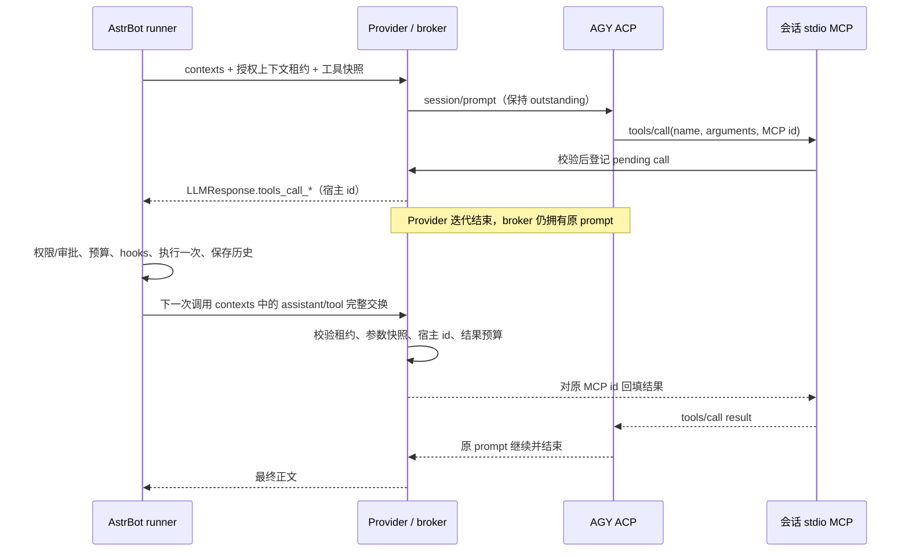

# M0：工具桥协议决策与实施门槛

状态：**源码核查和预检入口已交付；真实协议决策门未通过，工具能力仍关闭。**
本次基于插件 `55011cdc901cfe93428c23cc8f14d7fa9319bf1b`，保留任务书基线之后的两次文档提交。
本环境日期为 2026-11-06；原任务书的 2026-11-07 实测属于既有交接记录，本次没有重做或倒填该记录。

## 1. 审查结论与证据

任务书的隔离、单执行者、失败关闭及分阶段交付原则可执行。实施需要把以下三层证据分开：
规范允许某能力、CLI 宣告某能力、目标版本真实完成该能力，不能互相替代。

| 固定来源 | 本次核查位置与结论 |
|---|---|
| [ACP `7ec5185`](https://github.com/agentclientprotocol/agent-client-protocol/tree/7ec5185c18ca928b48e457d2d8a163800be013c8) | `schema/v1/schema.json` 的 `ToolCall`、`ToolCallUpdate`、`ClientRequest`、`PromptResponse`：工具更新是 agent 执行的状态；没有通用客户端提交工具结果并恢复推理的方法。只核查 v1 stable，未套用 v2/draft/RFD。 |
| 同上 | `ToolCall` 必需字段仅 `toolCallId`、`title`；`name`、`rawInput` 可缺失。`ToolCallUpdate` 只要求 ID。当前 v1 有可选 `name` 也不证明 AGY 1.5.2 会发送它。`title` 是展示文字，不能用来反推函数名。 |
| 同上 | `McpServerStdio` 使用 `name/command/args/env`；stdio 没有单独的协商布尔开关，HTTP/SSE 有 `mcpCapabilities`。stdio 类型存在不等于已验证 AGY 加载成功。 |
| 同上 | `PromptCapabilities.image` 与 `ImageContent(data, mimeType)` 定义真实图片块；没有给出可直接套用到 AGY 的统一大小/MIME 白名单。 |
| [AGY `e186eb5`](https://github.com/google-antigravity/antigravity-cli/tree/e186eb5819bc33ce2d9e26420f30f30ae289b1a5) | 官方仓库主要是 README、变更记录和示例，未提供可核查的 ACP/认证实现。README 描述系统 keyring 登录；不足以证实独立认证目录、文件后端、原子替换和共享刷新契约。不能把文档仓库 HEAD 当作 AGY 1.5.2 二进制。 |
| [AstrBot v4.29.4 `6133541`](https://github.com/AstrBotDevs/AstrBot/tree/61335414433db721b3f7ecc93f90deafe0a59d78) | `astrbot/core/provider/entities.py`：`LLMResponse.tools_call_name/args/ids` 为对应列表；`ToolCallsResult` 生成 assistant/tool 历史。 |
| 同上 | `astrbot/core/agent/runners/tool_loop_agent_runner.py`：`_iter_llm_responses` 主要通过 `contexts` 发送续轮历史，另传 `func_tool`、会话/对话 ID、abort signal；没有把 `run_context` 或完整授权对象交给 Provider。 |
| 同上 | `_handle_function_tools` 用当前工具集查找工具、调用 hooks 和 executor、处理消息/结果；`step` 持久化完整工具交换，`step_until_done` 管理预算。单独调用 `handler` 或 `FunctionToolExecutor.execute` 都不能替代完整 runner。 |
| 同上 | `skills_like` 会把 `func_tool` 换成轻量 schema，并在 `_resolve_tool_exec` 再请求参数；不能假定 Provider 收到可执行 handler 或完整 schema。 |

其他宿主风险：`on_tool_start` 的异常被记录后仍可能继续执行，不能把抛出 hook 异常当成拒绝授权；参数过滤也不等于完整 JSON Schema 校验。MVP 必须显式拒绝未知/无上下文/无权限的调用，审批拒绝必须走能阻止执行的入口。

## 2. 路线决策

**选择路线 B（受限 stdio MCP + pending-call broker + 原宿主 runner）作为唯一待验证主路线。**
这是设计选择，尚不是已可实现/可发布的结论。

路线 A 当前不成立：ACP 通知不保证执行前完整参数，权限回复只有选择/取消语义，不能携带宿主执行结果。将通知转成原生函数调用可能双重执行；拒绝权限后再把结果塞进文本也没有同一推理过程续接保证。

路线 B 用 MCP `tools/call` 的真实 name/arguments 建立待处理调用，保持 MCP 请求与原 ACP prompt 等待。broker 本身不执行任何工具：向 Provider 提供原生 `LLMResponse` 工具请求，由 AstrBot 原 runner 执行；下一次 Provider 调用从 contexts 校验并提取对应 tool result，回复原 MCP 请求。这里没有新增 ACP 暂停/恢复方法。

不同时实现另一个直调 executor 的执行引擎。若 broker 无法适配宿主生命周期，先提交宿主扩展方案，不切换成绕过 runner 的实现。



## 3. 所需最小宿主契约与锁分析

以下是**拟新增契约，不是 v4.29.4 已有 API**：

1. runner 为一次聊天运行建立不可从消息伪造的进程内租约，绑定 provider 实例、用户/群/会话/persona、完整允许工具快照及 schema 摘要；随 Provider 调用传递。仅 session_id 字符串不构成授权。匿名 API/摘要/健康检查不授予工具租约。
2. runner 在完成、异常、取消、预算耗尽、fallback、重载的 finally 路径显式结束租约；broker 取消 outstanding prompt 和 MCP 等待。不能只依赖“下一次调用总会发生”。预算耗尽时不能把插入的总结提示误当工具结果。
3. runner 对桥请求提供执行前 schema/权限/审批拒绝和确定的结果状态；历史未保存或被 hook 改写时，不回填另一份未审计结果。保留原 runner 的 hooks、直接发送消息、结果长度处理与执行上下文，不新建无上下文 executor。

宿主扩展至少涉及 Provider 调用参数与 runner 生命周期，需在目标版本独立测试和维护；插件不能用全局 monkeypatch 偷偷获得聊天权限。本 PR 不改 AstrBot 核心。

当前 `Runtime.stream` 的会话锁、并发槽和 `AcpClient.generate` 都覆盖整个生成生命周期，直接在这些位置等待宿主回填会形成循环等待。必须先把原 prompt 所有权交给独立 broker 任务：

- Provider 返回待执行调用时释放此次入口锁；会话进入专用 pending 状态，不能被普通生成复用、空闲淘汰或被另一聊天取得。pending 仍占有有界会话/进程预算。
- 续轮通过原租约进入专用回填入口，不重新申请被原 prompt 占用的生成槽，不发送第二个 `session/prompt`；等待结果时不持有回填所需锁。
- stdout reader 只路由有界事件，不等待审批或工具结果；MCP 读写与宿主等待分离，队列超限失败关闭。
- Provider 流结束与原 prompt 结束是不同事件。仅合法工具交接可保留 prompt；普通停止消费、异常和取消仍终止。需替换现有 generate finally 中的一律取消语义，不能简单删掉清理。

ID 分别保存：ACP `toolCallId` 仅展示关联；MCP JSON-RPC id 在该 MCP 连接内关联；随机宿主 call id 在租约/轮次内关联。ACP 与 MCP 无官方关联字段时记为未知，不能靠 title/参数相似度猜关联，更不能据此放行未知内置工具事件。这也是 M0 必须通过的阻塞探针之一。

## 4. 状态、历史与支持边界

状态：`GENERATING → WAITING_HOST → EXECUTING → WAITING_RESULT → GENERATING → DONE`；任意非终态可转 `CANCELLED/FAILED`。`EXECUTING` 需要宿主显式状态通知，不能仅凭返回 LLMResponse 推定执行已开始。

- MVP 只允许串行、只读、文本/JSON 结果；每轮调用次数、pending 数、审批/执行超时和结果字节预算均须有限。重复 id 只能匹配同一不可变调用，不触发第二次执行。
- MCP 名称映射由会话快照生成并保存双向表；必须无碰撞，不把名字拼成 shell。schema 或权限变化终止 pending 并重建；只接收完整 JSON 参数。
- 同一存活会话只接受闭合且匹配 pending 的 assistant/tool 单元。新建/压缩/编辑/回滚的工具历史没有经验证的原生恢复入口，MVP 暂拒绝；不得沿用首版文本 JSON 回放来宣称工具历史恢复完成。
- 执行前取消记“未执行”；宿主确认结果记“已完成”；执行中断/崩溃记“状态未知”。未知副作用不重放，进程内去重不保证跨崩溃 exactly-once。
- 工具 choice 首轮只计划支持 `auto`；`none` 须证明不加载/不调用工具；required/指定函数无对应可靠控制面时明确拒绝。现有代码行为本 PR 不扩展。

| 组合 | 本 PR / 后续门槛 |
|---|---|
| 现有纯文本、权限/文件/终端拒绝 | 保留现有能力与测试 |
| stdio MCP + 完整 schema + 有宿主租约 + 串行只读 | 待真实加载/关联/回填探针；本 PR 不启用 |
| skills_like、匿名调用、并行工具、历史重建 | MVP 暂不支持；需单独契约 |
| HTTP/SSE、公网代理、AGY 内置 shell/文件 | 不纳入主路线，保持关闭 |
| 图片 | 仅记录 capability 广告；大小/MIME/媒体来源、contexts-only 去重及真实读图另验收 |
| 音频/视频/PDF/图片生成 | 不支持 |

## 5. 本次证据与后续测试交接

本环境无 AGY 可执行文件、无目标 AstrBot 运行实例或已配置账号；没有读取凭据、安装 CLI、调用模型或执行真实工具。
运行 `python -m agy_provider.probe` 得到 `status=blocked, stage=discovery, error_code=NOT_INSTALLED`（退出码 2）。这是**环境前置失败**，不是 AGY 不支持 MCP 的证据。

预检复用插件隔离启动、能力协商和 `session/new`，不发 prompt、不加载 MCP、不运行登录流程、不读取认证文件；只输出白名单布尔能力、严格版本号、阶段和错误代码。临时会话在进程回收后删除。CLI 自己是否访问/刷新其官方认证后端由 CLI 决定，预检不承诺底层认证零写入。

```sh
python -m agy_provider.probe --command /absolute/path/to/agy --timeout 30
```

退出 0 只证明隔离建会话成功；不能证明生成、MCP、图片、凭据刷新。`AUTH` 时核查同一系统用户及官方认证后端搜索路径，不把整个 HOME 暴露给 agent，不复制 token。未知本地异常统一记 `LOCAL`，不输出原始异常或路径；中断退出 2。版本 banner 不符合白名单时记 `unrecognized`，由测试方另行记录官方版本。

按使用者要求，复杂测试交给后续测试方；本 PR 只运行既有回归及新增的短契约测试。后续按依赖顺序执行：

1. 官方 AGY 1.5.2 + 目标 AstrBot 4.29.4：记录版本/OS/后端类别，先完成隔离预检。账号由测试方使用同实例官方流程准备，不能用本次环境报告代替真实认证成功。
2. 独立探针安装**仅 echo** 的 stdio MCP，保持 AGY 内置工具关闭。先验证 initialize、tools/list、tools/call 的真实到达；只回显固定非敏感 JSON，记录计数及脱敏 ID 映射。若关闭内置工具同时屏蔽 MCP，记录失败，不开启 shell/file 兜底。
3. 暂留 echo 的 MCP response，确认原 ACP prompt 仍等待；回填一次后观察原 prompt 最终回答引用实际结果。同时确认 permission 与工具通知的顺序/关联能安全区分桥工具和内置工具。不得只看模型回答判成功。
4. 宿主租约适配后，把 echo 执行交给真实 runner，记录模型参数、宿主执行计数=1、结果回填三段证据；验证 contexts-only 续轮与流结束后的 broker 所有权。未完成此步不能宣称 M2 通过。
5. 再按任务书覆盖取消/拒绝/超时、重复与乱序、双群/双 Provider、20 轮历史、重载、认证自然刷新与图片。复杂测试不在本 PR 运行。

提交的协议夹具只能来自真实探针且经白名单脱敏；本次没有真实线上的 ACP/MCP 夹具，测试里的 mock 不是实测。独立审查及真实成功/失败探针仍为 M0 放行条件；两条路线都无法满足时保留文本模式，提交阻塞报告与宿主扩展成本，不继续 M2/M3。

## 2026-11-07 losvps 实测补充

后续外部真实探针已通过 M0：`session/new.mcpServers` stdio MCP 加载与 echo 回填成立，ACP 工具更新仅为状态通知；MCP `_meta` 含 conversation/root ID，图片图文/纯图读回成功。此事实更新不改写上文的旧阶段记录。当前实现、宿主 v4.29.4 接口边界、测试状态及报告/可执行 harness 的细节差异见 [M2/M3 实现与验收交接](M2_M3_IMPLEMENTATION.md)。本分支未自行运行真实闭环，仍需主代理运行验收脚本。
