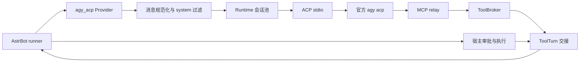

# 当前架构与源码导航

适用于发布基线 **v0.7.4**。运行范围为 AstrBot **`>=4.29.4,<4.30`**、Python **3.11+**；4.30 已知文案过滤不是宿主兼容声明。项目约束先读 [AGENTS.md](../AGENTS.md)，排错按 [SOP](troubleshooting.md)，验证按 [测试规范](testing.md)。本页描述当前契约，历史实现与各环境验收见 [CHANGELOG](../CHANGELOG.md)。

版本核对：[metadata.yaml](../metadata.yaml) 与 [_version.py](../agy_provider/_version.py) 的 `PLUGIN_VERSION`（由 [main.py](../main.py) 注册、[transport.py](../agy_provider/transport.py) clientInfo、[mcp_bridge.py](../agy_provider/mcp_bridge.py) serverInfo 统一引用，并由 [test_release_hygiene.py](../tests/test_release_hygiene.py) 强校验一致）当前均为 0.7.4。排障仍需同时记录部署 SHA 与各字段，不能仅凭标签判断代码版本。

当前维护中的宿主定点兼容及其退役条件见 [兼容补丁登记表](compatibility.md)；历史施工书与当前待办的区别见 [计划状态索引](plan-status.md)。

## 请求与工具数据流

普通回复沿 ACP 返回 Provider；工具模式在同一个原生 prompt 内暂停、交宿主执行并回填，再继续接收正文。图中的 MCP relay 是本地工具通道，模型流量仍由官方 CLI 处理。

## 模块职责

| 模块 | 当前职责 |
| --- | --- |
| [main.py](../main.py) | 生命周期、配置注入、管理员 `/agy setup`、`doctor`、`use`、`cost`，设置页与监控注册 |
| [provider.py](../agy_provider/provider.py) | 注册 `agy_acp`、Provider 请求/流式响应、模型/档位与工具模式、FailureGuard 接入、防重放标记 |
| [messages.py](../agy_provider/messages.py)、[media.py](../agy_provider/media.py) | 消息规范化、稳定 system/可信 transient、历史预算，图片格式/目录/SSRF 校验 |
| [system_prompt.py](../agy_provider/system_prompt.py) | `filter_host_capabilities()`，精确过滤失实宿主能力声明，独立定点改写已知 Safe Mode 单句，不修改用户历史 |
| [sessions.py](../agy_provider/sessions.py) | `Runtime`、会话租约/复用/退休、串行化、生成终态和错误归因 |
| [transport.py](../agy_provider/transport.py) | `AcpClient` 的 JSON-RPC、ACP 事件/usage、一次性权限、取消与有界输出 |
| [process.py](../agy_provider/process.py)、[paths.py](../agy_provider/paths.py)、[windows_job.py](../agy_provider/windows_job.py) | CLI 发现/参数并行探测与按文件元数据缓存、隔离目录与陈旧临时目录清扫、Windows 长路径与子进程树清理 |
| [tools.py](../agy_provider/tools.py)、[tool_turn.py](../agy_provider/tool_turn.py) | 工具快照、原始/模型 schema、`ToolBroker` 校验与预算、`ToolTurn` 宿主交接与回填 |
| [mcp_bridge.py](../agy_provider/mcp_bridge.py)、[bridge_transport.py](../agy_provider/bridge_transport.py) | MCP 子进程 relay、本地通道与 Windows 双向挑战认证 |
| [errors.py](../agy_provider/errors.py)、[notices.py](../agy_provider/notices.py)、[failure_guard.py](../agy_provider/failure_guard.py) | 错误分类、跨分片 CLI 告警过滤/快速中断、EMPTY 去重与额度/限流冷却 |
| [host_compat.py](../agy_provider/host_compat.py) | AstrBot runner 防重放兼容层；核验 4.29.4 的 fallback 入口 |
| [context_usage.py](../agy_provider/context_usage.py)、[telemetry.py](../agy_provider/telemetry.py) | 上下文占用、疑似压缩、计费 usage 与脱敏轮次记录 |
| [auth.py](../agy_provider/auth.py)、[login.py](../agy_provider/login.py)、[probe.py](../agy_provider/probe.py) | 文件桥、官方交互登录、无生成 ACP 检测 |
| [models.py](../agy_provider/models.py)、[onboarding.py](../agy_provider/onboarding.py) | 真实模型目录/选项，设置页检测、保存与宿主持久化 |
| [monitoring.py](../agy_provider/monitoring.py)、[views/setup/](../views/setup/) | 管理员只读监控 API、无构建步骤的 HTML/CSS/JS 设置页 |

## 会话、历史与防重放

- 稳定身份由 Provider 实例、AstrBot session、conversation 组成；缺少稳定身份不能冒用其他会话。工具请求还要求真实 ToolSet 和 `abort_signal` 生命周期；当活跃 `ToolTurn` 等待原调用方回填工具结果时，同一会话的其他并发新请求在 `queue_timeout` 内排队等待而不中断原工具轮。
- `sessions.compare_history()` 比较 `host_expected` 与新宿主历史；`sent_window` 单独记录实际发送窗口。`exact`、`host_trim`、`rewrite`、`append_gap`、`unknown` 是诊断关系，不能把相同尾部当作安全复用证明。
- `session_reuse_mode=strict` 为默认；`structured` 仅在 `messages.normalize()` 验证 `agy_context_parts` 后，把可信 transient 放入用户轮。无效/缺失分段不能升级为可信数据。模型、档位、稳定 system、工具指纹或历史语义变化可触发重建。
- [context_usage.py](../agy_provider/context_usage.py) 连续比较同一窗口的可信 `used/size`。默认峰值至少 64000、当前值严格低于峰值 50% 时标记疑似压缩；先完成本轮及工具回填，再退休。缺失/无效字段及窗口切换中断比较，不能据此证明上游压缩或计算账单。
- [provider.py](../agy_provider/provider.py) 在部分正文/思考或工具交接后失败时设置 `no_retry`、`no_fallback`；[host_compat.py](../agy_provider/host_compat.py) 补足宿主后续 fallback 入口的约束。输出前的去重/冷却仍可让宿主 fallback；不缓存成功答案，不自动续写或重放工具。
- 池默认 `max_concurrent=2`、`max_sessions=4`、`max_pending=16`、`idle_ttl=600` 秒。POSIX 使用独立进程组；Windows 尽早绑定 kill-on-close Job Object，失败时回退 `taskkill /T`。spawn/绑定并非原子操作，不能宣称宿主被强杀后任何平台都绝无残留。

## MCP 的两层权限与两份 schema

`transport.AcpClient._mcp_permission_option()` 只放行同时满足以下条件的请求：

1. 同一活跃、未终止、未超时的 ACP prompt，broker 未关闭且处于工具轮。
2. 严格 `mcp_astrbot_<wire_name>` 能映射到当前快照；同调用 ID 已被观测到，名称及 `pending/in_progress` 状态匹配。
3. 当前 prompt 尚未授权该 ID；选项结构有效、ID 不重复，且恰有一个 `allow_once`。

授权在写回复前登记，终态帧到达立即关闭窗口；其他 permission 返回 `cancelled`，其他未实现的客户端能力请求返回 JSON-RPC `-32601`。拒绝证据仅属于当前 prompt，最多 128 条，只含有界 method、名称和 ID，不含 arguments。

内置工具拒绝后，CLI 仍可能不把拒绝结果回喂模型就结束本轮。`TOOL_PERMISSION` 是插件侧归因，守卫提示仅减少误用；二者不代表该上游行为已修复，也不能根据合法 MCP 的选项推断尚未捕获的内置工具选项。

放行后 `ToolBroker.dispatch()` 继续检查活跃轮、会话元数据、工具名称、参数、次数/并发/结果预算；`ToolTurn` 交给 AstrBot 审批和执行，按审计过的调用及参数匹配回填。不能因 ACP 已许可就跳过宿主约束。

`ToolSnapshot.to_host_schema` 是独立深拷贝的宿主原始 schema；`tools[].inputSchema` 是 Gemini 适配 schema。缺失 array `items`（含 `anyOf`/`oneOf`/`allOf`、`additionalProperties` 与联合类型列表中的数组）时模型端保守补 string，执行端仍按原始契约接受原本合法的数字/对象/空/嵌套数组；显式 string items 继续拒绝非字符串。两份 schema 都进入快照指纹；并不据此保证模型实际会生成所有合法值或 Gemini 支持空 items。

## system 过滤与 429 的证据边界

在 Provider 规范化并验证可信分段之后，chat/tools 对稳定 system 应用同一过滤，再计算 system 哈希/字节数：

- 先独立处理已知 Safe Mode 第 4 条规则（#19）：仅在独占行的 `You are running in Safe Mode.`、可选空行、`Follow these rules:` 后的连续顶格 `- ` 列表内，将整句匹配的 `style/role-play` 定点改写为 `style and role-play`，保留安全约束及其余文字、尾随空白与 LF/CRLF。匹配只容忍大小写和句末句号差异，不扩展至其他词组拼写；改写幂等。4.30 已知 `<safety_instructions>` 包裹须完整、无嵌套，且内部只有该块及边界空行；这不代表支持 4.30 runner/API。
- 能力声明过滤优先移除精确独立行标签 `<execution_environment runtime="local">` 到结束标签之间、含已知宿主小节标记的完整块；支持 4.30 已知形态。
- 再移除 AstrBot 4.29.4 / 4.30 已知完整本地能力声明行，包括 Windows 已知变体。
- 未确认的标签/文案保留，只记录不含原文的 debug 原因。标签扫描与精确行扫描是两步：未确认标签内部若含已知精确声明行，该行仍会被第二步移除；不能承诺标签内每个字节都保留。
- 除上述已知能力声明过滤外，仅对已知 Safe Mode 单句做结构锚定的定点兼容改写，其余一律 fail-open：未知变体、残缺块、行中段、缩进、引用及代码围栏保留，只记无正文 debug 原因码。不修改人格其他部分、用户/助手历史、可信 transient 或宿主源对象，不做工具名审计替换或失败后的净化重试；不新增 telemetry 字段，不改变 `content_429_candidate` 结构。

`notices.RetryNoticeGuard` 从有界 CLI 摘要识别告警并过滤，非可靠的结构化上游错误通道。明确账号额度文案走 `QUOTA`，持续 429 走 `RATE_LIMIT`，暂态 503 不因单条重试告警直接开启额度冷却。`FailureGuard` 按 `(provider_id, model)` 共用 QUOTA/RATE_LIMIT 冷却，默认 60 秒、最长 300 秒，期满只允许一个 half-open 探测；EMPTY 默认去重 30 秒。候选标签不修改这些键、TTL 或成功清除语义。

失败轮若见过 detail-free `RESOURCE_EXHAUSTED` 摘要且最终为 QUOTA/RATE_LIMIT，`telemetry.TurnMeter.finish()` 可记录 `content_429_candidate`：`system_hash8`、`system_bytes`、`has_output`、`attempt`。**已有输出仍可能记录候选，必须检查 `has_output`**；纯 quota / 带结构化 details 的独立测试场景不产生候选。识别使用有界摘要且轮内信号可累积，不能当作原始 HTTP 响应或完整上游归因。来源：[端到端夹具](../tests/test_content_429.py)、[telemetry](../agy_provider/telemetry.py)。

## 用量、认证与 WebUI

- `usage_status=reported` 才是取得计费 usage；`not_sent` 表示未发模型 prompt，可记录 0；`unavailable` 表示发出但上游未报告，用 `null/未知`。上下文占用不等于计费输入、缓存率或账号余额。
- 每实例内存保留最近 24 小时最多 100 轮，重启清空；持久 `agy.turn` 日志默认关闭（`cost_log_enabled=false`）。原始会话身份不暴露，监控对嵌套字段做白名单投影。
- 文件桥只校验官方认证源的元数据，链接单个 `agy/antigravity-oauth-token`，不读取/复制内容。源缺失可尝试原生认证后端；不安全的现有文件为 `AUTH_BRIDGE`，不能靠忽略校验修复。
- [login.py](../agy_provider/login.py) 把单行 code 交给官方 `agy acp --login` stdin；不解析完整 localhost 回调 URL。登录进程退出 0 后仍要通过 ACP/目录复检。URL/ticket 仅返回发起者，不落盘、不写业务日志。
- [views/setup/app.js](../views/setup/app.js) 使用宿主注入的 `window.AstrBotPluginView`：先 `ready()`，再调用相对 `setup/status` 等 endpoint；不访问父页面 DOM、Dashboard token 或 LocalStorage。设置 POST 使用当前 nonce，后台动作须轮询终态；模型已保存但全局默认切换失败应显示部分成功。
- `GET monitor/status` 只收集现有实例快照，不启动 Runtime/CLI；仅配置中的 Dashboard 管理员可读，匿名 401，API Key/其他身份 403，停用 503，响应 `Cache-Control: no-store`。聊天管理员与 Dashboard 身份不是同一鉴权入口。
- 视图测试使用 DOM/bridge 替身；真实 iframe、主题、布局、剪贴板与 HTTP 鉴权需要另验。不要用静态页面预览替代宿主验收。
- 宿主把视图放进 `sandbox="allow-scripts allow-forms allow-downloads"` 的 iframe，且多数部署是 `http://<ip>`（非安全上下文）：`navigator.clipboard` 常为 `undefined`、`window.open` 可能被拦截。复制必须按「Clipboard API → 手势内同步 `execCommand` → 选中文本」降级，且轮询渲染不得重写未变化的 `input.value`（会折叠用户选区）。以上是宿主约束，不是插件缺陷，改动视图时保持不变式。

## 关键配置

完整字段/范围以 [_conf_schema.json](../_conf_schema.json) 和 [Settings.from_dict()](../agy_provider/config.py) 为准；修改后重载插件，提供商能力另行核对。

| 项目 | 当前默认与约束 |
| --- | --- |
| CLI | `command` 留空自动发现；显式值为原生可执行文件绝对路径，无 shell 参数；Windows 不用 `.cmd/.bat` |
| 代理 | `proxy_mode=inherit`；支持 `custom/direct`，custom 仅注入 CLI 子进程；容器内 localhost 指容器 |
| 工具 | `enable_tools=false`；还需宿主 `tool_use`、实际 ToolSet、身份/取消信号；`agy_tools_mode=inherit/chat/tools`，chat 无工具，tools 不能绕过总闸；`tool_choice` 仅 auto/none |
| 工具预算 | 16 次、并发 1、审批 60 秒、执行 120 秒、结果总计 262144 字节；超限报错，不静默截断 |
| 图片 | `enable_images=false`；还需宿主 image 与 CLI image 能力；PNG/JPEG 默认最多 8 张（可配 1–16），PNG 支持 8 位灰度/索引色/RGB/RGBA 并在校验 CRC 后剥离 `zTXt`/`iCCP`/`iTXt` 辅助块，字节/像素有界，本地目录必须在 `media_roots`；音频/视频/PDF/生成图片未接入。会话重建时，仅最新用户消息中的图片作为附件发送，历史图片在转录中仅保留哈希和 `historical` 标记。**v0.7.4 的剩余限制**：`prepare_media()` 仍会预检历史图片、占用本轮图片总数及字节预算；旧源失效或长会话累计图片过多可能在生成前失败，详见 [排障 SOP](troubleshooting.md#工具图片与监控)。 |
| 思考档位 | 调用 `agy_thought_level` 优先于 Provider `custom_extra_body`；选出的 default 继承全局 `thought_level`，全局也 default 才用 CLI 默认；始终校验当前模型目录/选项，不硬编码模型 ID |
| 历史/输出 | `history_bytes=160000`、`max_output_bytes=4194304`；不宣称原样发送无限历史，采样参数 temperature/top_p/max_tokens 无对应透传保证 |
| 组件实验 | `agy_customizations_mode=inherit`；minimal 仅在已探测支持参数的工具默认 Agent 启用，真实 MCP/A-B 仍需另验；不自动下载安装/热替换 CLI |

## 故障定位索引

| 故障或任务 | 入口源码/符号 | 对应测试 |
| --- | --- | --- |
| #24 历史图片被重复提取为当前附件 | [messages.py](../agy_provider/messages.py) `prompt_blocks` / `build_window` | [test_prompt_images.py](../tests/test_prompt_images.py)、[test_sessions.py](../tests/test_sessions.py) |
| #12 合法 MCP permission 被取消 | [transport.py](../agy_provider/transport.py) `_mcp_permission_option`、[tool_turn.py](../agy_provider/tool_turn.py) | [test_mcp_permissions.py](../tests/test_mcp_permissions.py)、[test_tool_pipeline.py](../tests/test_tool_pipeline.py) |
| #11 内置工具被拒后无正文 | [transport.py](../agy_provider/transport.py) `_reject_request`、[sessions.py](../agy_provider/sessions.py) `Runtime.stream` | [test_permission_attribution.py](../tests/test_permission_attribution.py) |
| #13 数组参数被桥拒绝 | [tools.py](../agy_provider/tools.py) `ToolSnapshot` / `ToolBroker.dispatch` | [test_tool_schemas.py](../tests/test_tool_schemas.py) |
| #14 本地能力声明/内容相关 429 | [system_prompt.py](../agy_provider/system_prompt.py)、[provider.py](../agy_provider/provider.py) | [test_system_prompt.py](../tests/test_system_prompt.py)、[test_content_429.py](../tests/test_content_429.py) |
| #19 Safe Mode 第 4 条提示词导致的 429 | [system_prompt.py](../agy_provider/system_prompt.py) `filter_host_capabilities` / `_rewrite_safe_mode_rules` | [test_safe_mode_rule.py](../tests/test_safe_mode_rule.py)、[test_system_prompt.py](../tests/test_system_prompt.py) |
| RATE_LIMIT / QUOTA / NETWORK 告警 | [notices.py](../agy_provider/notices.py)、[errors.py](../agy_provider/errors.py)、[failure_guard.py](../agy_provider/failure_guard.py) | [test_notices.py](../tests/test_notices.py)、[test_upstream_notice_filter.py](../tests/test_upstream_notice_filter.py)、[test_failure_guard.py](../tests/test_failure_guard.py) |
| EMPTY、复用或压缩后重建 | [sessions.py](../agy_provider/sessions.py)、[messages.py](../agy_provider/messages.py)、[context_usage.py](../agy_provider/context_usage.py) | [test_sessions.py](../tests/test_sessions.py)、[test_hardening.py](../tests/test_hardening.py) |
| 已输出/交接工具后发生重放 | [provider.py](../agy_provider/provider.py)、[host_compat.py](../agy_provider/host_compat.py) | [test_host_replay.py](../tests/test_host_replay.py)、[test_tool_pipeline.py](../tests/test_tool_pipeline.py) |
| CLI 启动/目录/进程残留 | [process.py](../agy_provider/process.py)、[paths.py](../agy_provider/paths.py)、[windows_job.py](../agy_provider/windows_job.py) | [test_process_hardening.py](../tests/test_process_hardening.py)、[test_paths.py](../tests/test_paths.py)、[test_main_init.py](../tests/test_main_init.py) |
| 登录、自检、模型保存 | [auth.py](../agy_provider/auth.py)、[login.py](../agy_provider/login.py)、[probe.py](../agy_provider/probe.py)、[onboarding.py](../agy_provider/onboarding.py) | [test_auth_config.py](../tests/test_auth_config.py)、[test_login.py](../tests/test_login.py)、[test_diagnostics.py](../tests/test_diagnostics.py)、[test_onboarding.py](../tests/test_onboarding.py) |
| 工具桥认证、畸形/过期调用 | [bridge_transport.py](../agy_provider/bridge_transport.py)、[tools.py](../agy_provider/tools.py) | [test_bridge_hardening.py](../tests/test_bridge_hardening.py)、[test_tool_pipeline.py](../tests/test_tool_pipeline.py) |
| 用量未知、上下文、监控权限/隐私 | [telemetry.py](../agy_provider/telemetry.py)、[monitoring.py](../agy_provider/monitoring.py) | [test_telemetry.py](../tests/test_telemetry.py)、[test_monitoring.py](../tests/test_monitoring.py) |
| 设置页/主题/后台状态 | [views/setup/](../views/setup/)、[onboarding.py](../agy_provider/onboarding.py) | [setup.test.mjs](../tests/setup.test.mjs)、[test_onboarding.py](../tests/test_onboarding.py) |
| 图片被拒或未传入 | [media.py](../agy_provider/media.py) | [test_media.py](../tests/test_media.py) |

按本表找文件后，用 `rg -n '符号或错误码' agy_provider tests` 定位；行号随提交变化，不以历史 issue 的旧行号替代当前源码。
