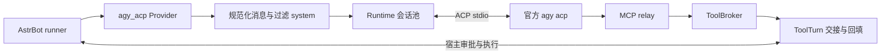

# 当前架构与源码导航

运行范围见 [metadata.yaml](../metadata.yaml)，Python 3.11+。从报错切入用[故障定位索引](troubleshooting.md#故障定位索引)，修改接口先查[后端契约](api.md)。

## 请求与工具数据流

[main.py](../main.py) 注入配置、注册指令与视图，初始化诊断并恢复 Provider，停用时关闭相应服务。[provider.py](../agy_provider/provider.py) 选择模型、档位和工具模式，接收宿主请求并向 runner 交付流式事件。[process.py](../agy_provider/process.py) 发现、探测和启动官方 CLI，[transport.py](../agy_provider/transport.py) 管理 JSON-RPC、事件、权限和取消。

## 会话、历史与防重放

- [sessions.py](../agy_provider/sessions.py) 用 Provider、宿主会话和 conversation 确定身份。活跃工具轮等待回填时，同会话新请求按 `queue_timeout` 等待。`compare_history()` 用 `host_expected` 核验宿主历史，`sent_window` 单独记录实际发送窗口。相同尾部不足以证明可复用。
- [messages.py](../agy_provider/messages.py) 将当前输入与有界历史分开。确认的 `_no_save` 临时文本照常发送，只从预期回放排除。宿主序列化丢标记时，仅在原始附加内容全为文本且位置、顺序和内容吻合时恢复。默认 `strict`，`structured` 只接受验证过的 `agy_context_parts`。模型、档位、稳定 system、工具指纹或历史变化均可能重建。历史图片经 `media.py` 轻量元数据或语法检查后保留哈希占位，不占当前附件预算。只有当前最新用户轮图片经过完整校验后随请求发送。
- [context_usage.py](../agy_provider/context_usage.py) 用同一窗口的有效 `used/size` 判断疑似压缩，配置阈值命中后在本轮及工具回填完成后退休。上下文占用与计费 usage 各有独立来源。
- Provider 在可见正文、内置工具已记为使用、工具交接或工具结果续轮后失败时标记 `no_retry` 和 `no_fallback`。[host_compat.py](../agy_provider/host_compat.py) 包装受支持的 runner，阻止后续 fallback Provider 被调用。仅思考/进度且未交接、未执行工具的失败可保留宿主显式 fallback 资格。

### 无工具收尾与超时恢复

普通 MCP 续轮通过 `ToolTurn.accept()` 审计调用和结果，然后继续同一个 ACP prompt。隔离的两条无工具路径由 `chat_events()` 分派。

| 触发 | 执行与边界 |
| --- | --- |
| 已交接工具超过 `tool_execution_timeout` | `ToolBroker.dispatch()` 置 `execution_timed_out` 并抛出 `TOOL_TIMEOUT`，由 `ToolTurn` 关闭 `Runtime.stream()` 以结束原 prompt。`Runtime.stream()` 记录有界调用 ID，仅在原 CLI 会话仍活、宿主 signal 未取消时保留有效期为 `idle_ttl` 的 `TimedOutTool`。宿主实际返回闭合结果后，须匹配同会话、同一未取消 signal、存活的 CLI、模型/档位、稳定 system、`source_revision`、`transient_hash` 及包含原调用名称和参数的历史哈希。先用 `check_result()` 校验结果，再消耗恢复标记。 |
| 受支持 runner 到达 `max_steps` | `host_compat.max_steps_notice()` 根据当前 runner、signal、步数和拔掉的工具集识别收尾。属于同一运行的保留工具 prompt 会退休，由已闭合历史生成总结。若完成收尾后又收到一组闭合工具交换，仅在当前会话仍活、同一 signal、历史前缀及模型/档位/system 匹配、调用未登记为已处理时允许一次文本收尾。 |

两条路径都把已完成结果作为文本历史送入一次新无工具 prompt，禁用 MCP 和可选原生工具。收尾或恢复失败仍受防重放保护，即使宿主已裁掉旧工具历史。超时路径通过校验后即消耗标记，生成失败也不可再次提交。已识别的超时回填失配、失效或重复报 `TOOL_TIMEOUT`，禁 retry/fallback。缺少超时证据的旧回填（如重载后）或不匹配的收尾回填报 `TOOL_STALE`。格式、预算错误保留对应错误码。两组回归见 [test_tool_pipeline.py](../tests/test_tool_pipeline.py) 和[宿主源码离线检查](testing.md#宿主源码离线检查)。

## MCP 的两层权限与两份 schema

- `AcpClient._permission_option()` 仅在活跃工具 prompt 内，对当前快照严格映射的 `mcp_astrbot_<wire_name>`、已观察到且名称/ID/状态匹配的调用，选择唯一有效、未消费的 `allow_once`。登记早于回包，终态立即关闭窗口。`ToolBroker.dispatch()` 再校验调用、参数、预算和会话，`ToolTurn` 交宿主审批执行并审计回填。
- [tools.py](../agy_provider/tools.py) 将 `ToolSnapshot.to_host_schema` 与 `tools[].inputSchema` 分开复制，两份皆参与指纹。模型 wire 可为缺失 array `items` 补 string（含组合和联合类型）；桥执行使用原始 schema，保留原本合法数组，显式 string 仍约束元素。
- [builtin_tools.py](../agy_provider/builtin_tools.py) 的 `BUILTIN_SPECS` 是原生工具注册表。`provider.py`、`sessions.py` 和 `process.py` 允许受控原生工具在空 MCP 快照下使用默认 agent（`mcpServers: []`，无 relay 子进程）；`chat` 或 `tool_choice=none` 维持无工具隔离。具体版本、许可与共享预算只在[工具策略](api.md#工具策略)维护。

## system 过滤与 429 的证据边界

[system_prompt.py](../agy_provider/system_prompt.py) 在请求规范化后处理稳定 system。先锚定完整 Safe Mode 规则列表，定点等义改写已知第 4 条（#19）；再移除已知本地能力的完整块或精确独占行（#14）。未知结构中的已知精确声明行仍适用第二步。保留其余人格、历史及可信 transient。4.30 的文案识别范围见[兼容登记](compatibility.md)。

[notices.py](../agy_provider/notices.py) 有界识别 CLI 告警。[FailureGuard](../agy_provider/failure_guard.py) 仅对 `QUOTA` / `RATE_LIMIT` 按 `(provider_id, model)` 冷却。`EMPTY` 优先按 `(provider_id, "req", logical_request_id)` 去重，否则按 `(provider_id, "sess", session_key, request_fingerprint)`，缺少有效键则不去重。`content_429_candidate` 仅记录脱敏哈希、大小、输出标记与 attempt，可出现在已有输出的轮次，无法归因到上游内容过滤或账号额度。见 [429 排障](troubleshooting.md#rate_limit--quota-与-14)。

## 用量、认证与 WebUI

- [auth.py](../agy_provider/auth.py) 只核验认证源元数据并链接单文件。源缺失可尝试原生认证，已有不安全文件报 `AUTH_BRIDGE`。[login.py](../agy_provider/login.py) 按发起者返回临时授权信息，将单行 code 交给官方 CLI。登录退出成功后仍需 [probe.py](../agy_provider/probe.py) 验证握手、会话与目录。
- [views/setup/](../views/setup/) 直接分发原生 HTML/CSS/JS，由 `AstrBotPluginView` 提供相对接口。设置页不访问父页面 DOM 或 Dashboard token，本地存储仅用于非敏感主题偏好。默认页为运行监控，其余为模型管理、环境与认证、工具权限。受限 iframe 的复制降级见[排障](troubleshooting.md#工具图片与监控)。[onboarding.py](../agy_provider/onboarding.py) 管理检测、缓存和宿主模型保存，[routing.py](../agy_provider/routing.py) 读取及修复路由。端点见[模型管理](api.md#模型管理与路由)。
- [telemetry.py](../agy_provider/telemetry.py) 区分 `reported`（取得 usage）、`not_sent`（未发模型 prompt，可记零）、`unavailable`（已发出，缺失量保持 `null`）。[monitoring.py](../agy_provider/monitoring.py) 只读本地快照，[quota.py](../agy_provider/quota.py) 是独立的官方 CLI 查询服务。

### 监控明细存储

| 数据 | 存储与故障行为 |
| --- | --- |
| [每日用量](../agy_provider/daily_usage.py) | `daily-usage-v1.sqlite3` 按结算时宿主本地日历和模型汇总，每次入账清理早于 365 日窗口的行。只存聚合数值；不可用时每日接口返回 `STORAGE_UNAVAILABLE`，生成继续。 |
| [逐轮明细](../agy_provider/turn_history.py) | `turn-history-v1.sqlite3` 独立版本化。UTC 时间窗口为 24 小时，读取排除过期和未来记录。每实例 100 轮、全库 2,000 轮、主库 8 MiB 上限，另有 SQLite 临时回滚日志。锁、权限、库损坏或不支持的 schema 导致内存降级；重载重试，保留原文件。 |
| [失败诊断](../agy_provider/failure_events.py) | `failure-events-v1.json` 独立保存 7 天、最多 128 条、64 KiB 的脱敏事件。明细恢复不重记失败事件或每日用量。 |

逐轮明细白名单包括匿名实例/样本键、UTC 时间、模型/模式、状态/错误码、耗时、已知 Token、复用/缓存和重建原因等脱敏字段。聊天、提示词、图片、工具参数/结果、凭据、原始会话标识、上下文状态不得落盘。宿主配置中随机 `agy_history_id` 和实例 ID 导出持久匿名键。原位编辑保留身份，旧样本保留原模型；删除重建分配新键，未补标或身份不唯一时仅内存记录。

结算时写入短事务，同一实例和样本键去重。恢复只填入 tracker 窗口并换算单调时间，不走结算流程。ACP 进程、会话池、工具账本/授权及当前上下文从新运行时建立。没有落盘的旧轮次无法回填。`agy.turn` 详细日志受 `cost_log_enabled` 独立控制，默认关闭。

## 关键配置

完整默认值和范围见 [_conf_schema.json](../_conf_schema.json)、[Settings.from_dict()](../agy_provider/config.py)。

- `command` 留空自动发现，显式值为原生可执行绝对路径。`proxy_mode=inherit/custom/direct` 中 custom 仅注入 CLI 子进程。隔离 `--gemini-dir`、`--app-data-dir` 和工作目录。POSIX 使用进程组，Windows 用 Job Object 并保留 `taskkill /T` 降级。进程启动与 Job Object 绑定并非原子操作，宿主被强杀后仍可能残留子进程。
- `enable_tools`、`enable_images` 默认关闭。工具模式 `inherit/chat/tools` 受总闸控制；MCP 需实际 ToolSet、宿主会话身份及取消信号，图片需宿主 `image` 模态及 CLI 能力。当前图片遵守 [media.py](../agy_provider/media.py) 的格式/CRC、根目录、SSRF、大小和像素预算。
- `agy_thought_level` 调用覆盖优先于实例设置，`default` 继承全局，全局也为 `default` 则使用 CLI 默认。可用模型/选项由 [models.py](../agy_provider/models.py) 核验。`agy_customizations_mode=minimal` 仅在支持该参数的工具默认 agent 上生效，真实 A/B 另验。

## 故障定位索引

见[症状 → 源码 → 测试 → 排障](troubleshooting.md#故障定位索引)。
